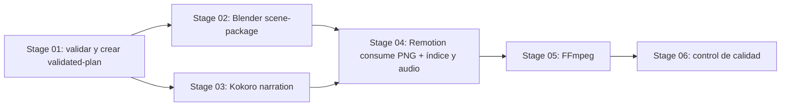

# Phase 5A — Blender Productive Adapter Architecture

**Status:** propuesta documental para revisión; no implementada ni aprobada para producción.
**Paquete objetivo:** `cinematic-shorts-pipeline` v0.10.
**Compatibilidad exigida:** `pipeline_version: 1`, `manifest_version: 1`, fingerprints y ejecución productiva Kokoro de Phase 4B sin cambios.

## 1. Diagnóstico de la arquitectura actual

La auditoría se realizó sobre `scripts/pipeline.py`, `scripts/tts-kokoro-worker.py`, `templates/pipeline.json`, las referencias de orquestación, seguridad, animación 3D, cinematografía y Remotion, el roadmap y las suites de pipeline, TTS productivo/publicación y manifiestos.

### Reutilizable

- `pipeline.py` ya valida el DAG y las rutas relativas del proyecto, captura hashes de inputs, construye fingerprints por etapa, inicializa manifiestos v1 y comprueba el SHA-256 de cada artefacto de salida.
- Stage 01 produce y vuelve a verificar `validated-plan`; Phase 4B persiste checkpoints por reemplazo atómico del manifiesto y publica outputs sin overwrite.
- Los helpers de publicación inspeccionan symlinks/reparse points, verifican identidades y limitan limpieza a archivos propios. Son patrones de referencia; no prueban aislamiento ni eliminan carreras frente a procesos locales hostiles.
- El worker Kokoro fija una tarea, construye el comando en código, valida el runtime real, evita `shell=True`, impone timeout y no ejecuta comandos declarados en JSON.
- Storyboard v1 identifica escenas/plano, rangos `[start_frame, end_frame)`, FPS, proporción, intención de cámara, luz, animación y continuidad. Los validadores prueban forma/cronología, no interpretan ni demuestran geometría 3D.
- La composición prevista consume `scene-package` y `narration`; manifiestos registran cada salida como un artefacto con ruta y SHA-256.

### Requiere diseño adicional

- El runner productivo actual solo acepta Stage 01 + Stage 03 Kokoro y exige que 02/04/05/06 sigan pending. No se puede activar Blender cambiando solo `adapter_status`.
- La plantilla declara Stage 02 como `02-blender-scenes`, con inputs `storyboard`/`validated-plan` y una salida `.pipeline/work/scenes.json`. Ese JSON único no define todavía el contrato de recursos ni contiene evidencia de que Blender haya ejecutado.
- El manifiesto v1 almacena un único path/hash por artefacto declarado; no modela colecciones de archivos, por lo que un paquete multi-escena debe publicarse como un archivo contenedor único o requeriría una migración contractual.
- El storyboard solo expresa intención narrativa. No contiene parámetros suficientes para que un renderer construya de forma inequívoca objetos, materiales, trayectorias 3D ni activos.
- `profile.limits` expresa presupuestos. No impone límites de memoria/VRAM al proceso del motor.
- `pipeline_version: 1` admite recursos con `id`, `path`, `required` y `kind` opcional, pero no declara licencia, atribución ni esquema de escena.

## 2. Alternativas de paquete

| Alternativa | Ventajas | Costes y límites | Evaluación |
|---|---|---|---|
| Solo `.blend` por escena | Editable y nativo de Blender; pequeño frente a imágenes animadas. | No acredita por sí solo que la escena se haya renderizado; Remotion necesitaría importar/renderizar `.blend`, lo que no es su consumidor previsto. Manifiesto v1 no representa varios `.blend`. | Insuficiente como entrega productiva Stage 02. |
| Solo secuencia PNG por escena | Evidencia visual verificable; Remotion puede consumir imágenes por frame; sin decoder específico. | Puede ocupar mucho espacio; no conserva escena fuente editable; duración y orden requieren índice explícito. | Adecuada para transferencia, incompleta como paquete de producción editable. |
| Solo glTF/USD u otro export | Formato de intercambio útil para escenas 3D. | Añade soporte de exporter/importer, recursos externos y compatibilidad de materiales/animación; un archivo no prueba render correcto. La necesidad de Remotion debe confirmarse contra versiones instaladas. | Demasiado alcance para el MVP. |
| `.blend` más renders PNG en un ZIP | Un artefacto de manifiesto v1; conserva fuente editable y evidencia que Blender realmente produjo; Remotion consume la secuencia y el índice. | Renderiza y almacena ambas representaciones; requiere límites de tamaño y un validador de ZIP estricto. El hash del ZIP prueba integridad del paquete, no calidad visual. | **Recomendado para MVP.** |

### MVP de evidencia y tamaño

El MVP queda fijado en una escena original: storyboard `schema_version: 1`, `aspect_ratio: "9:16"`, `fps: 12`, `total_frames: 24`, escena con `[start_frame, end_frame) = [0, 24)`; el perfil del pipeline debe coincidir exactamente con ancho 540, alto 960 y 12 FPS. Duración nominal: `24 / 12 = 2` segundos. El renderer produce exactamente 24 PNG, uno por frame fuente `0..23`.

Se recomienda **Cycles con dispositivo CPU** como ruta inicial. Su ventaja para el primer MVP es que el dispositivo de render no depende de GPU, backend gráfico, VRAM disponible ni contexto GPU de Windows/headless. Es una ruta disponible en Windows y en ejecución background según el modelo de dispositivos documentado por Blender; la compatibilidad concreta de la instalación debe verificarse durante la futura prueba real. Riesgo: el i3-10F puede tardar considerablemente; no hay benchmark todavía y no se promete duración de render. La escena mínima, resolución, muestras y timeout se fijan antes del gate; si no termina, reducir muestras o geometría en una revisión aprobada, no cambiar de backend automáticamente. “Reproducible” aquí significa inputs, engine, dispositivo, seed y parámetros fijados y registrados; no promete pixeles/hash idénticos entre versiones de Blender o CPUs distintas.

Eevee se descarta para este MVP CPU. Es rasterizado GPU-only: su uso headless en un Windows sin contexto gráfico soportado no es admisible como ruta inicial; además depende de driver/OpenGL y consumo de VRAM, y Windows puede terminar operaciones GPU largas. Reevaluarlo solo con requisito verificable de GPU/driver/contexto y una prueba real específica. Referencias: [limitaciones Eevee 5.2](https://docs.blender.org/manual/en/5.2/render/eevee/limitations/limitations.html), [dispositivo de render Cycles 5.2](https://docs.blender.org/manual/en/5.2/render/cycles/render_settings/index.html), [requisitos de GPU Cycles](https://docs.blender.org/manual/en/5.2/render/cycles/gpu_rendering.html).

El primer gate local guarda un `.blend` editable y los 24 PNG verificados, separados de una revisión humana visual. Un tope inicial propuesto de 512 MiB comprimidos y 1 GiB descomprimidos limita publicación/lectura, no rendimiento ni memoria del proceso Blender. Los límites de frames/dimensiones evitan que el perfil solicite cargas superiores al MVP.

El MVP usa geometría original simple declarada en JSON, sin descarga ni recursos 3D externos. Así verifica generación, cámara, iluminación, render y transferencia sin confundirlo con compatibilidad de rigs o licencias de assets. La futura admisión de assets existentes necesita su propio formato allowlist, inventario de licencia y pruebas de rutas.

## 3. Decisión arquitectónica recomendada

### Runner compartido con ejecutor Stage 02 separado

Extender el orquestador existente mediante un runner productivo separado y explícito para Stage 02, reutilizando validación, DAG, fingerprints, manifiesto v1, checkpoints y publicación. Blender se invoca por worker fijo del repositorio (`blender-scenes-worker.py`); no se crea un segundo manifiesto ni se replica Stage 01.

**CLI aprobada para Phase 5B:**

```text
run-productive-scenes CONFIG --blender ABSOLUTE_PATH
```

Este comando ejecuta Stage 01 y luego Stage 02. Stage 03, 04, 05 y 06 permanecen `pending`. La ruta debe ser absoluta y existente; no se busca en PATH, no se instala Blender. El perfil TTS de Phase 4B continúa usando `run-productive-tts`; ese comando conserva su contrato Stage 01 + Stage 03 y rechaza Stage 02 productiva. No se diseña aún un comando combinado.

Responsabilidades con fuente de verdad única:

- **Proceso padre (`pipeline.py`):** valida config/storyboard/inputs, crea y verifica `validated-plan`, calcula todos los fingerprints y hashes, establece el manifiesto/checkpoints, crea staging exclusivo y request JSON acotado, arma argv fijo, lanza/termina Blender, confirma que inputs no cambiaron, construye `package.json`/`provenance.json`/ZIP desde resultados, valida el ZIP sin extraer, calcula SHA-256 final, publica sin overwrite y actualiza/verifica el único manifiesto.
- **Blender + worker fijo:** lee solo el request previamente validado, construye el `.blend` y renderiza PNG dentro del staging indicado por el padre. Devuelve por stdout un recibo de runtime observado y nombres/rangos producidos. No calcula hashes autoritativos, no empaqueta ZIP, no publica, no actualiza manifiesto ni decide estados.
- **Verificador en proceso padre:** único responsable de validar inventario, hashes, PNG, runtime y provenance; una etapa se completa solo después de reread/hash del ZIP publicado y checkpoint durable del manifiesto.

La composición de DAG objetivo queda así:



En una ejecución Stage 02 aislada, el manifiesto puede tener Stage 01 y Stage 02 completed y las demás etapas pending si cumplen las reglas generales del manifiesto; Stage 04+ no se marca como ejecutada. El perfil combinado futuro puede completar 01/02/03. El ejecutor Phase 4B actual seguirá aceptando solo su perfil productivo 01/03 y rechazará Stage 02 implementada, según su contrato actual.

## 4. Contrato propuesto de inputs y validación

### Inputs efectivos

- `storyboard`: bytes actuales del storyboard declarado en `project.storyboard`.
- `validated-plan`: salida verificada de Stage 01 correspondiente a la misma configuración, storyboard, recursos y DAG.
- `resource-<id>` para cada recurso requerido que use Stage 02, declarado explícitamente en `project.resources` y también explícito en `stages[02].inputs`. No descubrir archivos por glob ni tomar recursos implícitos del filesystem.
- `pipeline-config` no se añade al Stage 02 como una nueva convención. La configuración y el perfil ya forman parte del cálculo actual de `stage_fingerprint`; preservar la pseudoentrada reservada a Stage 01 según Phase 4A.

### Recurso de especificación para el MVP

Añadir una allowlist/schema cerrada para un recurso requerido `kind: blender-scene-spec`, almacenado como JSON UTF-8. Un documento declara exactamente una escena, con `scene_spec_version: 1`, `project_id`, `scene_id`, `render`, `materials`, `objects`, `camera` y `lights`. Todos los objetos deben tener claves exactas; campos desconocidos, claves duplicadas, floats no finitos, IDs duplicados, recursos no declarados o valores fuera de límites se rechazan. No hay `extensions`, `extras` ni defaults tácitos.

Contrato v1 exacto:

- `project_id` debe igualar el proyecto. `scene_id` debe identificar la única escena del storyboard y se fija a un slug ASCII. El MVP exige que esa escena cubra `[0,24)` sin huecos.
- `render` requiere exactamente: `width: 540`, `height: 960`, `fps: 12`, `start_frame: 0`, `end_frame_exclusive: 24`, `engine: "CYCLES"`, `device: "CPU"`, `samples: 8`, `threads: 2`, `seed` entero entre 0 y 2147483647 (semilla efectiva por frame: `(seed + source_frame) mod 2147483648`), `denoising: false` y `image_format: "PNG_RGB8_SRGB"`. Cualquier discrepancia con storyboard/profile se rechaza; no se convierte ni retima.
- `materials` requiere de 1 a 12 objetos `{id, base_color_linear_rgba, metallic, roughness}` exactos. RGBA tiene cuatro números en `[0,1]`; metallic en `[0,1]`; roughness en `[0.05,1]`. IDs son slug ASCII único.
- `objects` requiere de 1 a 24 objetos `{id, primitive, material_id, location_m, rotation_rad, scale}` exactos. `primitive` permite solo `cube`, `uv_sphere`, `cylinder` o `plane`; `material_id` debe resolver a material local declarado. Coordenadas de ubicación se acotan a `[-20,20]` m; rotación a `[-6.28319,6.28319]` rad; cada escala a `[0.05,10]`. No se aceptan instancias ni generadores arbitrarios.
- `camera` requiere exactamente `{lens_mm, interpolation, keyframes}`. `lens_mm` entre 24 y 50; `interpolation` exactamente `LINEAR`; `keyframes` contiene exactamente dos objetos `{frame, location_m, target_m}` en frames 0 y 23, con ubicación/destino xyz en `[-20,20]` m y distancia cámara-destino mayor que 0.01 m. La ubicación o el target del frame 23 debe diferir al menos 0.01 m del frame 0 para acreditar movimiento de cámara. La orientación deriva del target; interpolación lineal de ubicación/target; no existen defaults de cámara ni keyframes intermedios declarables.
- `lights` requiere de 1 a 3 luces area con claves `{id, type, location_m, target_m, color_linear_rgb, power_w, size_m}`. `type` es `AREA`; ubicación/target en `[-20,20]` m; RGB en `[0,1]`; potencia entre 1 y 2000 W; size entre 0.1 y 10 m; ubicación distinta del target.

El worker implementa la política cerrada `blender-scene-policy-v1`; estos valores no son defaults de Blender, sino valores que el worker asigna explícitamente y registra. Construye una escena vacía; primitivas centradas con dimensiones base cube 2 m, UV sphere radio 1 m, cylinder radio 1 m/profundidad 2 m y plane 2×2 m en XY; aplica `scale` como factor sobre esa malla. Material Principled BSDF recibe color/metallic/roughness declarados; alpha=1, IOR=1.5, emisión=0 y los demás sockets quedan fijados por policy (no se leen del archivo de usuario). Luz `AREA` de forma square, apunta al target declarado y usa `size_m`/`power_w`; no hay luces o materiales automáticos adicionales.

La policy fija cámara vertical con sensor fit `VERTICAL`, sensor width 36 mm, clip 0.01–100 m, DOF off y orientación -Z/up Y dirigida a `target_m`. Las dos posiciones/targets se interpolan linealmente. World background es negro lineal con strength 0; no hay compositor, motion blur, transparencia de film ni salida alfa. Cycles: CPU, 8 samples, adaptive sampling off, denoising off, max bounces 4 (diffuse/glossy/transmission máximo 2 cada uno), caustics off, semilla por frame según fórmula anterior. Output: PNG RGB8, 100% resolution, pixel aspect 1:1, resolución/FPS del spec, frame start 0 y end Blender inclusivo 23, color management `Standard`, exposure 0, gamma 1 y display sRGB. El worker asigna todos estos valores en código, falla si la versión no expone/acepta un ajuste requerido y comprueba valores efectivos antes de guardar/renderizar.

No se habilitan addons, motores externos, scripts de proyecto, texturas/archivos externos ni autoexec; no hay retiming ni archivos fuente de usuario. Guarda propiedades efectivas en `.blend` y recibo runtime. Cualquier futura ampliación de claves/policy es una revisión del schema/versionado, no aceptación implícita.

El JSON de especificación se declara como recurso requerido del proyecto y como `resource-<id>` en `stages[02].inputs`, así su SHA-256 afecta Stage 02. El MVP no importa archivos `.blend`, scripts, addons, ejecutables ni assets externos. Si se admite un asset en otra fase, su fichero debe ser un recurso requerido separado, listado explícitamente en Stage 02, con inventario/licencia asociado. Como `project.resources` hoy no acepta campos de licencia, Phase 5B debe usar un sidecar de licencia cerrado/versionado para assets o añadir campos opcionales compatibles en una revisión contractual; esto no bloquea el MVP sin assets.

El worker solo interpreta `scene_spec_version: 1`. Versiones desconocidas, claves desconocidas, ID o frames que no correspondan exactamente al storyboard y referencias no declaradas se rechazan antes de lanzar Blender.

## 5. Contrato del `scene-package`

Stage 02 conserva un solo output en el DAG: `.pipeline/work/scenes.zip` (o ruta de output configurada con extensión `.zip`). Es el artefacto `scene-package` del manifiesto v1. La etapa Blender no escribe ZIP, índice, provenance ni hashes autoritativos: produce únicamente `scenes/<scene-id>/scene.blend` y los PNG bajo staging exclusivo asignado por el padre. El padre crea y valida todo lo demás.

Estructura lógica recomendada:

```text
scene-package.zip
  package.json
  provenance.json
  scenes/<scene-id>/scene.blend
  scenes/<scene-id>/frames/frame-000000.png
  ...
  scenes/<scene-id>/frames/frame-000023.png
```

`package.json` lista orden, intervalos semiabiertos, FPS, dimensiones y cada payload con tamaño y SHA-256. Para evitar autocontención imposible, no incluye hashes de sí mismo ni de `provenance.json`; el SHA-256 externo del ZIP en el manifiesto v1 cubre ambos. `provenance.json` informa `record_type: productive-local-blender-scenes`, versión de provenance, IDs de corrida/proyecto/etapa, versión observada (`bpy.app.version` y `version_string`), SHA-256 del ejecutable/worker, inputs/fingerprints, motor/dispositivo/configuración efectiva, dimensiones/FPS/frames, semilla y tiempos observados. No incluye rutas absolutas/timestamps de máquina como inputs de fingerprints.

#### Contratos JSON cerrados para scene-package v1 (Phase 5B.5A)

Ambos documentos son objetos UTF-8 JSON, máximo 1 MiB cada uno. Se rechazan BOM, claves repetidas en cualquier profundidad, constantes JSON no estándar (`NaN`/`Infinity`), campos desconocidos o faltantes y tipos coercibles (en particular, boolean no equivale a integer). Los hashes son SHA-256 hexadecimal minúscula de 64 caracteres. IDs de proyecto/escena y de recursos son slugs ASCII `[a-z0-9]+(?:-[a-z0-9]+)*`; el `run_id` es UUID canónico en minúsculas. No se permiten extensiones ni defaults implícitos.

`package.json` tiene exactamente estas claves de nivel raíz:

| Campo | Tipo y valor/rango | Relación |
|---|---|---|
| `package_version` | integer `1` | Versión de este índice; independiente de `pipeline_version` y `manifest_version`. |
| `record_type` | string `blender-scene-package` | Discriminador fijo. |
| `project_id` | slug ASCII | Debe coincidir con provenance y contexto externo, si se proporciona. |
| `stage_id` | string `02-blender-scenes` | Stage propietario único del artefacto. |
| `scene_id` | slug ASCII | Debe coincidir con provenance y ser el único segmento variable de las rutas. |
| `timeline` | objeto exacto `{source_start_frame, source_end_frame_exclusive, fps_num, fps_den, frame_count}`; todos integers | Valores fijados a `0`, `24`, `12`, `1`, `24`, respectivamente; rango semiabierto `[0,24)`, duración exacta 2 s. |
| `render` | objeto exacto `{width, height, image_format}` | `540`, `960`, `PNG_RGB8_SRGB`. Cada PNG debe cumplir además el decoder RGB8 completo. |
| `payloads` | array de 25 objetos discriminados por `role` | Primero una escena Blender y luego los frames 0–23 en orden de número de frame; no contiene los dos JSON. |

Cada payload `role: scene-blend` tiene exactamente `{role, path, size_bytes, sha256}`, ruta `scenes/<scene_id>/scene.blend`, `size_bytes` integer en `[12, 536870912]` y `sha256` válido. Cada payload `role: frame-png` tiene exactamente `{role, path, source_frame, size_bytes, sha256}`, `source_frame` integer `0..23`, ruta `scenes/<scene_id>/frames/frame-<source_frame:06d>.png`, `size_bytes` integer `1..33554432` y hash válido. El inventario ZIP son esos 25 payloads más `package.json` y `provenance.json`: exactamente 27 miembros.

`provenance.json` tiene exactamente estas claves de nivel raíz:

| Campo | Tipo y valor/rango | Relación |
|---|---|---|
| `provenance_version` | integer `1` | Versión de este recibo. |
| `record_type` | string `productive-local-blender-scenes` | Discriminador fijo; es una declaración del padre y no prueba ejecución por sí sola. |
| `run_id` | UUID canónico | Debe coincidir con la corrida del manifiesto/contexto proporcionado. |
| `project_id`, `stage_id`, `scene_id` | slug/string | Deben igualar los valores del índice; `stage_id` es `02-blender-scenes`. |
| `runtime` | objeto exacto `{blender_version, blender_version_string, blender_version_cycle, blender_executable_sha256, worker_version, worker_sha256}` | Tupla integer `[5,2,patch]` con `patch` entre 0 y 99; string normalizado `5.2.<patch>`; cycle `release`; SHA válidos; `worker_version` integer `1`. No se acepta versión de runtime inferida del JSON de configuración. |
| `inputs` | objeto exacto `{validated_plan_sha256, stage_01_fingerprint, stage_02_fingerprint, input_hashes}` | Los tres primeros valores son hashes válidos. `input_hashes` es array sin duplicados, ordenado por `id`, de objetos exactos `{id, sha256}`; incluye `storyboard`, `validated-plan` y exactamente el recurso `resource-<id>` de tipo scene-spec usado por Stage 02. No contiene rutas. |
| `render` | objeto exacto `{policy_id, engine, device, width, height, fps_num, fps_den, source_start_frame, source_end_frame_exclusive, samples, threads, seed, denoising, image_format}` | Política `blender-scene-policy-v1`; `CYCLES`/`CPU`; `540`×`960`; `12/1`; `[0,24)`; 8 samples; 2 threads; seed integer `0..2147483647`; denoising `false`; `PNG_RGB8_SRGB`. Debe coincidir con `package.json` y el perfil. |
| `observed` | objeto exacto `{frames, minimum_camera_target_distance_m, render_seconds, worker_seconds}` | `frames` es exactamente `[0,...,23]`; las métricas son números finitos, no booleanos, no negativos; distancia mínima `>0.01`. Son valores observados que declara el proceso padre a partir de su recibo worker. |

La validación opcional de contexto usa un `ScenePackageContext` creado por el llamador a partir del proyecto/storyboard/scene-spec/validated-plan y manifiesto ya validados. Incluye `project_id`, `scene_id`, `run_id`, `stage_01_fingerprint`, `stage_02_fingerprint`, `input_hashes` con los SHA-256 actuales y `manifest_scene_package_sha256`. El validador compara todos esos valores con índice, provenance y SHA-256 exterior real del ZIP. El llamador conserva la responsabilidad de comprobar que el manifiesto v1 declara Stage 01/02 como `completed`, que el artefacto corresponde a `scene-package` y que sus dependencias/configuración/DAG son semánticamente actuales. Sin contexto externo, el resultado certifica integridad estructural y consistencia interna únicamente; nunca afirma autenticidad, que Blender ejecutó, que abrió el `.blend` ni que el manifiesto valida.

El ZIP de MVP es classic single-disk ZIP sin ZIP64, preámbulo, comentario, encryption, data descriptor ni campos extra. Solo acepta compresión STORE/DEFLATE, flags cero y entradas de archivos regulares; el sistema creador puede ser DOS/Windows o Unix, pero Unix file type debe ser regular o no declarado. El central directory y cada local header deben concordar en nombre, método, flags, CRC, tamaños y offsets; no hay rangos de miembros solapados. Los nombres son ASCII POSIX allowlisted, únicos con comparación case-insensitive. Fechas DOS deben tener componentes válidos, pero no aportan provenance ni identidad. Antes de construir `ZipFile`, se comprueba el EOCD fijo al final, su cuenta exacta de 27 y se prelee el central directory con presupuesto derivado de 27 registros y el máximo nombre ZIP de 65,535 bytes; no se permite que un directorio central con millones de entradas haga que `zipfile` materialice metadata sin límite.

Los límites son ZIP exterior 512 MiB, 27 miembros, expansión total 1 GiB, razón por miembro como máximo 100, JSON 1 MiB, `.blend` 512 MiB y PNG 32 MiB. Se validan antes de abrir el reader y nuevamente durante la lectura de cada miembro. Cada miembro se consume a EOF en bloques acotados; `zipfile` comprueba su CRC y el padre compara además bytes expandidos reales, SHA-256 e inventario con el índice. JSON pequeños se almacenan dentro del límite para parseo estricto; los demás payloads no se materializan. PNG se pasa como stream directamente al decoder 5B.4. `.blend` se consume completo/hash y se comprueba solo la cabecera de 12 bytes `BLENDER`, clase de puntero/endian válidas y versión de archivo 502; eso no garantiza que Blender pueda abrirlo.

### Índice temporal y numeración

Cada escena lleva `source_start_frame`, `source_end_frame_exclusive`, `fps_num: 12`, `fps_den: 1` y `frame_count: end-start`. Para el MVP: `[0,24)`, 24 frames y duración exacta 2 s. El PNG `frame-000000.png` corresponde al frame fuente 0 y tiempo `0/12`; `frame-000023.png` al frame 23 y tiempo `23/12` s. Los frames representan muestras de tiempo dentro del intervalo total semiabierto `[0,2 s)`; no se crea un frame 24 ni se incluye un duplicado del límite final.

Los nombres son seis dígitos decimales del frame fuente global, consecutivos desde `start_frame`; no reinician por archivo. Para escenas futuras, cada escena usa sus frames globales propios y rangos no solapados/continuos conforme al storyboard. El padre exige cardinalidad exacta, sin huecos/duplicados. Remotion en Phase 5C debe componer a 12 FPS y mapear `source_frame = start_frame + composition_frame - scene_start`; no cambia FPS ni interpola/descarta/repite frames. 30 FPS y cualquier conversión temporal quedan fuera de Phase 5B y requieren decisión explícita futura.

### Validación read-only estricta del ZIP

`validate-manifest` no puede crear directorios/archivos temporales, extraer ni invocar procesos. Debe abrir el artefacto existente en modo lectura y validar todos sus miembros en streaming mediante `zipfile`/lecturas seekables del propio archivo. Durante la ejecución productiva sí se permite staging privado exclusivo; la validación final usa el mismo validador en memoria/lectura, sin extraer al filesystem. El worker escribe las imágenes ya separadas en staging; el padre no necesita extraer el ZIP para crearlo o validarlo.

El parser acepta solo el inventario esperado y compresión ZIP almacenada/deflate, rechaza cifrado, directorios como miembros, enlaces Unix/symlinks, tipos especiales, nombres duplicados y colisiones case-insensitive. Los paths internos deben ser ASCII POSIX relativos con nombres y prefijos allowlisted (`package.json`, `provenance.json`, `scenes/<slug>/scene.blend`, `scenes/<slug>/frames/frame-<6 dígitos>.png`); rechaza absolutos, `..`, `.`, segmentos vacíos, backslash, drive letters, UNC, NUL y nombres fuera de inventario. Límites propuestos: 27 miembros para MVP (dos JSON + blend + 24 PNG), ZIP <=512 MiB, expansión total <=1 GiB, JSON <=1 MiB cada uno, `.blend` <=512 MiB, PNG <=32 MiB cada uno, razón expansión/comprimido <=100 y exactamente 24 frames. Todos los valores se verifican antes/durante lectura con contadores acumulados, no confiando solo en cabeceras centrales.

Se consume cada miembro entero en chunks acotados para comprobar que `zipfile` valida CRC al EOF y calcular SHA-256 esperado; no se materializan los payloads en RAM. Para PNG, la validación debe decodificar los datos, no limitarse a cabecera/firma: aceptar el perfil RGB8 no entrelazado fijado por el contrato, verificar CRC y orden de chunks, alimentar IDAT incrementalmente a zlib con límite de expansión, exigir stream completo y checksum final correcto, exactamente 960 scanlines de `1 + 540×3` bytes, filtros PNG válidos (0–4) y reconstrucción de cada fila. Rechazar payload comprimido corrupto aunque su CRC de chunk haya sido recalculado, truncamiento, filas faltantes/excedentes, filtro inválido, IDAT incompleto, IEND ausente, trailing compressed data y toda condición de decodificación inválida. La memoria máxima de scanlines se mantiene acotada a dos filas RGB más buffers limitados. El decoder puede ser una implementación estrecha del perfil PNG del MVP usando `zlib` de la biblioteca estándar; no instalar Pillow ni otra dependencia en esta fase.

En paralelo se valida magic/header `.blend` y cada PNG completamente decodificado a RGB8 540×960, y se compara inventario/hash/tamaño del JSON índice con bytes del miembro. JSON estricto rechaza claves duplicadas/desconocidas y comprueba scene IDs, frames, timeline, provenance/runtime y valores contra storyboard/config/manifest. Se verifican `ZipInfo.file_size`, `compress_size`, flags, modo/tipo, count y CRC durante streaming; valores falsificados/inconsistentes se rechazan. El artefacto exterior se hashea por separado y debe coincidir con el manifiesto.

Los checks de rutas symlink/junction/reparse aplican al path del ZIP en proyecto y a sus padres; no hay extracción a directorio destino en `validate-manifest`, por tanto no existe un árbol de extracción que revisar. Estas comprobaciones reducen errores dentro del modelo de proyecto local confiable, sin prometer resistencia TOCTOU frente a actor local hostil.

Durante `run-productive-scenes`, Blender escribe solo al staging exclusivo y el padre crea ZIP/JSON en staging, valida el paquete íntegro en read-only, vuelve a verificar inputs, publica únicamente el ZIP con creación exclusiva, relee SHA-256 final y luego persiste Stage 02 completed. Ningún parcial se adopta automáticamente. Si Stage 04 necesita archivos descomprimidos, los extraerá a su propio staging durante su futura ejecución después de verificar el paquete; no se extraen durante planificación ni validación de manifiesto.

### Transferencia a Remotion

Remotion recibe `package.json` más secuencias PNG por escena, sus rangos/FPS y el artefacto de narración por separado. La capa de composición coloca cada secuencia usando offsets explícitos y sincroniza el audio; no importa `.blend` ni ejecuta Blender. Stage 04 deberá verificar hashes del paquete y secuencias antes de usarlos. Esta propuesta no certifica compatibilidad de una versión de Remotion no fijada por el proyecto y no atribuye render final al Stage 02.

## 6. Ejecución segura de Blender

- CLI exacta: `run-productive-scenes CONFIG --blender ABSOLUTE_PATH`. La ruta se valida como absoluta, archivo regular no symlink/reparse, ejecutable y existente. No se busca PATH ni instala/descarga runtime.
- Consultar versión real del binario con argumento fijo y confirmar dentro del worker `bpy.app.version`/`version_string`; incompatibilidad de ambos valores falla. `availability: verified` solo permite elegibilidad declarativa, nunca sustituye la sonda real.
- Construir argv solo en código con `shell=False`, cwd del proyecto, worker fijo, `--background`, `--disable-autoexec`, `--python-exit-code 1` y `--threads 2`. Nunca pasar comandos, scripts, expresiones, módulos o addons desde el JSON. Confirmar el orden de argumentos con la versión del runtime aprobada.
- **Motor inicial: Cycles CPU.** Fijar `scene.render.engine = CYCLES` y dispositivo `CPU` en código/request; verificar el dispositivo efectivo y registrar su identidad. Cycles documenta CPU como dispositivo compatible, configurable sin GPU. Es la opción inicial reproducible para Windows/headless porque no depende de GPU/contexto gráfico; no garantiza rapidez. El CPU puede exceder timeout y RAM incluso a 540×960, 24 frames; el benchmark local decidirá si los topes/sample count son prácticos.
- **Eevee:** requiere GPU; descartar cualquier documentación o implementación que lo describa como renderer CPU. Blender documenta Eevee como GPU-only y no soportado en headless Windows. Reconsiderar solo con GPU/driver/contexto gráfico comprobado en la configuración destino, pruebas headless Windows aprobadas y control/observación de VRAM; no fallback dinámico a Eevee.
- El worker fijo interpreta spec v1 cerrada y crea `.blend` + PNG únicamente bajo staging exclusivo. El padre crea índice/provenance/ZIP, hashea y valida outputs, ejecuta publicación/manifiesto. Ningún hash autoritativo procede del worker.
- Timeout/cancelación debe terminar proceso Blender y descendientes de forma acotada, esperar término y registrar outcome; `subprocess.run(timeout=...)` por sí solo no asegura terminar árbol de proceso de forma portable. Modelar no-cero, crash y timeout. No retries/resume.
- `--threads 2` limita hilos configurados en Blender, no CPU total. RAM/VRAM del profile son presupuestos: no cuotas del OS. No afirmar hard limit salvo soporte de OS implementado y probado. Para la ruta CPU VRAM no controla render, aunque Blender/UI/GPU sigan consumiendo memoria.
- No hay aislamiento completo de filesystem ni red. Blender corre con permisos del usuario. La validación de paths y `--disable-autoexec` reducen superficie, no convierten Blender en sandbox. El MVP no abre archivos externos ni addons.

La documentación oficial respalda capacidades/limitaciones de motores, background/argumentos y versión API, no el rendimiento real. Fuentes: [limitaciones Eevee 5.2](https://docs.blender.org/manual/en/5.2/render/eevee/limitations/limitations.html), [Cycles Render Device 5.2](https://docs.blender.org/manual/en/5.2/render/cycles/render_settings/index.html), [Cycles GPU Rendering 5.2](https://docs.blender.org/manual/en/5.2/render/cycles/gpu_rendering.html), [argumentos Blender 5.2](https://docs.blender.org/manual/en/5.2/advanced/command_line/arguments.html), [API `bpy.app` 5.2](https://docs.blender.org/api/5.2/bpy.app.html), [formatos de imagen](https://docs.blender.org/manual/en/5.0/files/media/image_formats.html). Ninguna referencia acredita una ejecución en el hardware de referencia.

## 7. Secuencia de ejecución propuesta

```mermaid
sequenceDiagram
  participant CLI as run-productive-scenes / pipeline.py
  participant FS as Proyecto / staging / publicación
  participant Blender as Blender instalado
  participant W as worker fijo del repo
  CLI->>FS: validar profile/storyboard/spec/inputs y outputs libres
  CLI->>CLI: validar DAG/fingerprints; generar validated-plan determinista
  CLI->>FS: publicar y reread/hash validated-plan; checkpoint Stage 01
  CLI->>Blender: ruta absoluta + versión real
  CLI->>FS: crear staging exclusivo y request validado
  CLI->>Blender: background + CPU Cycles + worker fijo
  Blender->>W: worker lee solo request validado
  W->>FS: guardar scene.blend y 24 PNG dentro de staging
  W-->>CLI: recibo runtime observado y frames; sin hashes autoritativos
  CLI->>FS: revalidar config/inputs; construir índice/provenance/ZIP
  CLI->>FS: validar ZIP read-only, CRC/miembros/PNG/SHA
  CLI->>FS: publicar ZIP sin overwrite; reread y hash final
  CLI->>FS: Stage 02 completed + checkpoint de único manifest v1
```

El padre inicia una invocación con Stage 01 y Stage 02 elegibles; Stage 03/04/05/06 quedan pending en el runner aislado. Crash entre publicación ZIP y checkpoint puede dejar huérfano: no se adopta ni se borra automáticamente; siguiente run usa destinos libres y la inspección/recuperación manual es responsabilidad del operador.

## 8. Compatibilidad Phase 4B y manifiestos v1

- El perfil nuevo de `run-productive-scenes` debe contener Stage 01 implementada y Stage 02 elegible/implementada; Stage 03 permanece `pending`, igual que 04/05/06. El ejecutor no requiere el perfil TTS productivo.
- Stage 01 vuelve a validar pipeline, storyboard, spec y recursos requeridos actuales, crea el mismo `validated-plan` canónico que representa la configuración y **todo el DAG**, incluido Stage 03 pendiente. El recibo conserva IDs/inputs/dependencias/outputs/estados declarados, waves deterministas, profile/workspace relativos, input entries con SHA-256 y `pipeline-config` semántico como pseudoentrada Stage 01. No filtra textos narrativos ni rutas absolutas.
- El proceso padre relee el recibo publicado y lo compara byte-a-byte/semánticamente contra `_validated_plan` esperado usando la config actual, storyboard, recursos, waves y validación. Antes de Stage 02 vuelve a verificar los mismos inputs/config; tras render los compara nuevamente para detectar cambios concurrentes. Stage 02 depende exclusivamente de Stage 01 y recibe su hash `validated-plan`, storyboard/spec/resources explícitos. Esto preserva invalidación/fingerprint por el algoritmo actual sin cambiarlo.
- `validate-manifest` debe decidir validación semántica del recibo por elegibilidad de perfil productivo: TTS Phase 4B **o** escenas Phase 5B; esa lectura es estrictamente read-only y el ZIP se inspecciona en streaming sin extraerlo ni crear temporales. En el perfil escenas, aunque Stage 03 esté pending, si Stage 01 está completed el comando verifica validated-plan contra config/storyboard/resources/DAG actuales. No deducir ejecución de `availability`; los IDs/contratos manifest v1 permanecen. Si Stage 01 no está completed no hay recibo por validar y pending sigue válido.
- No modificar `stage_fingerprint`, `fingerprint`, `pipeline_version: 1`, `manifest_version: 1`, shapes heredadas, ni hacer obligatorios nuevos campos en manifests existentes. Cada resource usada por Stage 02 es input explícito y su hash se incluye en fingerprint Stage 02; su runtime/worker efectivo se incorpora con patrón actual `tool_versions`.
- `run-productive-scenes CONFIG --blender ABSOLUTE_PATH` ejecuta 01 y 02; manifiesto único v1 indica completed solo esas dos y pending 03/04/05/06. Outputs `.blend`/PNG internos al ZIP se validan; el artefacto manifestado es solo `scene-package` ZIP con SHA-256 externo.
- `run-productive-tts` mantiene exactamente Stage 01+03 Kokoro, outputs, verified-plan semantics y aceptación existente. No habilita Stage 02 ni cambia por el nuevo perfil. Los fixtures/manifiestos v1 heredados deben seguir pasando sin migración ni reinterpretación de sus fingerprints.
- El comando combinado 01/02/03 se considera futuro separado; no entra a Phase 5B.

## 9. Fallos y modelo de amenazas

Stage 02 solo llega a `completed` después de código Blender exitoso, verificación de versión observada, cierre de inputs sin cambios, paquete completo y verificaciones de integridad posteriores a publicación. Fallos en sonda, constructor, render, versión, timeout, cancelación, crash, paquete, SHA o manifiesto dejan etapa `failed` (o `blocked` si ni siquiera era elegible) sin artefactos reutilizables. No publicar resultados parciales como válidos.

| Caso | Respuesta requerida |
|---|---|
| Ejecutable ausente, no absoluto, no ejecutable o versión fuera de rango | Fallar preflight antes de cambiar estado de Stage 02 a running; sin descarga. |
| Versión declarada válida pero runtime real incompatible | Worker/probe rechaza; Stage 02 failed. |
| Escena/spec desconocida, recurso ausente, licencia incompleta o SHA cambiado | Rechazar antes de Blender; no resolver rutas externas ni descargar. |
| Output/manifest existente, symlink, junction, reparse, ZIP path traversal o nombres duplicados | Rechazar sin overwrite; no extraer fuera de staging. |
| Blender no cero, excepción, timeout, cancelación o crash | No completar; conservar reporte de error limitado y parcial para inspección manual; no adoptar ni borrar sin identidad probada. |
| ZIP válido exterior con miembro alterado, falta frame, PNG corrupto/métricas incorrectas o provenance incoherente | Rechazar y mantener Stage 02 failed; hash del contenedor no basta para semántica. |
| Input cambiado durante render o concurrencia sobre mismo output | Comparar hashes/config antes y después; fallo, sin completar; publicación de destino exclusivo. |
| Crash después de publicar ZIP y antes del manifiesto final | Artefacto huérfano no válido/reutilizable; siguiente ejecución debe usar destino nuevo y reparación manual. |
| RAM/VRAM excedida o proceso del sistema finalizado | Fallo si se detecta; si no existe límite OS real, documentarlo como presupuesto no aplicado. |

Prueba con mocks puede cubrir el protocolo y no demuestra que Blender ni una escena real funcionen. Para proyecto local confiable, aun con autocarga deshabilitada y worker fijo, Blender puede leer/escribir archivos con los permisos del usuario. No se ofrece aislamiento total de filesystem, red, CPU, RAM ni VRAM.

## 10. Matriz de pruebas para Phase 5B

CI en Ubuntu 24.04, Ubuntu 26.04 y Windows 2025 no instalará ni ejecutará Blender. Inyectar un launcher fake/runner determinista y fabricar ZIP/PNG mínimos válidos en fixtures; nunca etiquetar estos tests como inferencia o render real.

| Grupo | Casos mínimos |
|---|---|
| Perfil y DAG | Stage02 exacta, deps Stage01, inputs/resources exactos; perfil no elegible/additional dep/recurso desconocido rechazado antes del worker; Stage04/05/06 pending. |
| Compatibilidad | Todas las pruebas actuales pasan; comandos `run-productive-tts` y `run-tts-kokoro` idénticos; manifests/fingerprints v1 legacy fixtures aún pasan; Stage02 no puede entrar al runner TTS. |
| Runtime/worker | ruta relativa, missing/non-executable, versión unsupported, salida malformada, retorno no cero, firma worker/version mismatch, fallo de `bpy` observado y asset hash cambiado. |
| Especificación | JSON profundo/grande/malformado, claves desconocidas, script/URL/command/path, scene IDs faltantes/duplicados, frame fuera del storyboard, valor no finito y referencias de recurso no declaradas. |
| ZIP/publicación | ZIP válido; traversal POSIX/Windows/UNC, symlink entry, case collisions, miembro duplicado, exceso de ratio/tamaño/count, CRC malo; colisión y reparse; verificación de cada hash; sin overwrite. |
| Decodificación PNG | IDAT corrupto con CRC de chunk recalculado, zlib truncado, checksum malo, scanline truncada/excedente, filtro inválido, dimensión/formato/entrelazado incorrecto, IEND ausente y trailing compressed data; toda falla invalida Stage 02 aunque las cabeceras sean correctas. |
| Semántica | paquete recalculado con frame omitido, PNG truncado, dimensión/FPS/rango erróneo, provenance/worker/runtime alterado con SHA exterior actualizado; `validate-manifest` debe fallar. |
| Concurrencia y crashes | input/config mutado durante worker; output disputado; timeout/cancelación/crash en cada checkpoint; huérfano no se adopta; Stage02 nunca completed antes de reread/hash final. |
| Solo lectura | validate/plan/dry-run/validate-manifest no crean archivos ni llaman worker/procesos/red según las garantías que ya tienen. |

### Gate local posterior, explícito

Después de implementar Phase 5B y disponer de Blender instalado por el usuario, ejecutar manualmente un caso pequeño opt-in con ejecutable absoluto ya existente. Registrar la versión real `bpy.app`, hashes, parámetros, tiempos, tamaño de paquete y revisión visual humana; conservar evidencia fuera de Git si contiene medios privados. No instalar ni descargar. Una prueba con mock, el metadato de versión del ejecutable o un `.blend` guardado no sustituyen este gate.

## 11. Riesgos y decisiones pendientes antes de Phase 5B

1. **Validación de scene spec:** verificar en Phase 5B que el esquema cerrado v1 se implementa sin defaults y que cada campo se mapea a las propiedades guardadas en `.blend`. El storyboard por sí solo no basta para geometría reproducible.
2. **Worker/código Blender:** confirmar compatibilidad API con Blender 5.2.3 y rango soportado. En esta auditoría no se ejecutó Blender ni se verificó runtime local funcional; el dato anterior de metadatos de instalación no equivale a prueba.
3. **Motor/performance:** motor de MVP decidido como Cycles CPU; medir tiempo/tamaño/uso en equipo objetivo antes de dar por aceptable el límite. Eevee GPU solo vuelve a evaluarse con contexto/driver headless verificados; no hay benchmark de ninguno.
4. **Recursos/licencia:** MVP no importa recursos externos. Antes de admitirlos, decidir contrato de licencia sidecar/campos opcionales sin romper `pipeline_version: 1`, y cómo verificar restricciones sin conexión.
5. **Archivo ZIP:** usar `zipfile` de la biblioteca estándar, ZIP almacenado/deflate allowlisted y lectura streaming sin extracción en validación. Phase 5B debe probar límites, CRC, lectura sin escrituras y reproducibilidad del índice. Hash de integridad no garantiza mismo ZIP binario entre versiones/plataformas.
6. **CLI/perfil:** Phase 5B usa `run-productive-scenes CONFIG --blender ABSOLUTE_PATH`; el runner aislado deja Stage 03/04/05/06 pending. No modificar contrato existente de `run-productive-tts`.
7. **Duración/FPS de MVP:** fijados en una escena 540×960, 12 FPS, frames `[0,24)` y 24 PNG. La utilidad/rendimiento queda pendiente de la prueba real; conversión a 30 FPS queda fuera de Phase 5B.
8. **Transferencia Remotion:** fijar contrato de escena, temporización y decoder de secuencia contra la versión real de Remotion; Phase 5A no afirma integración compatible ejecutada.
9. **Verificación visual:** definir quién aprueba still y secuencia y dónde se registra sin presentar validación técnica como aprobación artística.

## 12. Plan incremental y criterios de aceptación

### Phase 5B — Blender productive Stage 02

1. Implementar exactamente scene spec v1 y perfil 540×960/12 FPS/[0,24), Cycles CPU, CLI separada y topes acordados; runtime Blender real sigue siendo preflight obligatorio.
2. Implementar allowlist/validación de inputs, preflight Blender real y worker fijo; no scripts desde pipeline JSON ni descarga.
3. Reutilizar helpers de Stage 01, fingerprint, manifiesto v1, checkpoints y publicación; activar Stage02 solo en perfil nuevo/opt-in. Preservar `run-productive-tts` y entradas/manifiestos v1 heredados.
4. Implementar ZIP autocontenido con `.blend`, 24 PNG, índice/provenance parent-owned, validación read-only streaming de CRC/hashes/dimensiones y publicación exclusiva; no extraer en validate-manifest.
5. Añadir tests mock multiplataforma por la matriz anterior; ejecutar suite completa. No descargar Blender en CI.
6. Criterio técnico: éxito mock genera manifiesto v1 válido; 01/02 completed solo después de reread/hash; 03/04/05/06 pending para runner Stage02 aislado; fallo nunca produce Stage02 completed ni output reutilizable; Phase 4B sin regresiones.
7. Criterio local separado: un run Blender real en escena mínima y revisión humana de still/secuencia evidencia cámara/movimiento; publicar versiones, hashes, tiempos, tamaños y limitaciones reales sin confundirlo con rig/personaje/audio/video final.

### Phase 5C — transferencia y composición audiovisual (propuesta)

Definir e implementar consumidor Remotion del ZIP/index y secuencias PNG, sincronía explícita con narración y verificación por frame/escena. Dejar render de video final, FFmpeg, QA y aprobación cinematográfica como etapas separadas con contratos/validación propios. No introducirlos en Phase 5B por adelantado. Fijar aceptación visual humana y evidencia reproducible antes de llamar productivo al assembly.

---

## Referencias oficiales

- Blender 5.2 Manual, [Command Line Arguments](https://docs.blender.org/manual/en/5.2/advanced/command_line/arguments.html): background, orden de opciones, `--threads`, `--disable-autoexec`, `--python-exit-code`.
- Blender Python API 5.2, [`bpy.app`](https://docs.blender.org/api/5.2/bpy.app.html): versión/runtime observados.
- Blender 5.0 Manual, [Supported Graphics Formats](https://docs.blender.org/manual/en/5.0/files/media/image_formats.html) y [Output Properties](https://docs.blender.org/manual/en/5.0/render/output/properties/output.html): formatos de salida y PNG/EXR.

Las referencias de manual sustentan capacidades documentadas, no ejecución comprobada en el equipo de referencia.
