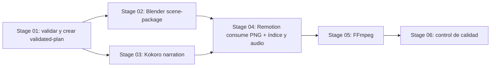
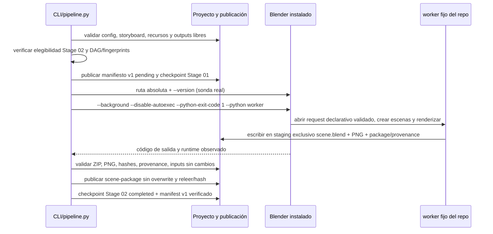

# Phase 5A — Blender Productive Adapter Architecture

**Status:** propuesta documental para revisión; no implementada ni aprobada para producción.
**Paquete objetivo:** `cinematic-shorts-pipeline` v0.10.
**Compatibilidad exigida:** `pipeline_version: 1`, `manifest_version: 1`, fingerprints y ejecución productiva Kokoro de Phase 4B sin cambios.

## 1. Diagnóstico de la arquitectura actual

La auditoría se realizó sobre `scripts/pipeline.py`, `scripts/tts-kokoro-worker.py`, `templates/pipeline.json`, las referencias de orquestación, seguridad, animación 3D, cinematografía y Remotion, el roadmap y las suites de pipeline, TTS productivo/publicación y manifiestos.

### Reutilizable

- `pipeline.py` ya valida el DAG y las rutas relativas del proyecto, captura hashes de inputs, construye fingerprints por etapa, inicializa manifiestos v1 y comprueba el SHA-256 de cada artefacto de salida.
- Stage 01 produce y vuelve a verificar `validated-plan`; Phase 4B persiste checkpoints por reemplazo atómico del manifiesto y publica outputs sin overwrite.
- Los helpers de publicación inspeccionan symlinks/reparse points, verifican identidades y limitan limpieza a archivos propios. Son patrones de referencia; no prueban aislamiento ni eliminan carreras frente a procesos locales hostiles.
- El worker Kokoro fija una tarea, construye el comando en código, valida el runtime real, evita `shell=True`, impone timeout y no ejecuta comandos declarados en JSON.
- Storyboard v1 identifica escenas/plano, rangos `[start_frame, end_frame)`, FPS, proporción, intención de cámara, luz, animación y continuidad. Los validadores prueban forma/cronología, no interpretan ni demuestran geometría 3D.
- La composición prevista consume `scene-package` y `narration`; manifiestos registran cada salida como un artefacto con ruta y SHA-256.

### Requiere diseño adicional

- El runner productivo actual solo acepta Stage 01 + Stage 03 Kokoro y exige que 02/04/05/06 sigan pending. No se puede activar Blender cambiando solo `adapter_status`.
- La plantilla declara Stage 02 como `02-blender-scenes`, con inputs `storyboard`/`validated-plan` y una salida `.pipeline/work/scenes.json`. Ese JSON único no define todavía el contrato de recursos ni contiene evidencia de que Blender haya ejecutado.
- El manifiesto v1 almacena un único path/hash por artefacto declarado; no modela colecciones de archivos, por lo que un paquete multi-escena debe publicarse como un archivo contenedor único o requeriría una migración contractual.
- El storyboard solo expresa intención narrativa. No contiene parámetros suficientes para que un renderer construya de forma inequívoca objetos, materiales, trayectorias 3D ni activos.
- `profile.limits` expresa presupuestos. No impone límites de memoria/VRAM al proceso del motor.
- `pipeline_version: 1` admite recursos con `id`, `path`, `required` y `kind` opcional, pero no declara licencia, atribución ni esquema de escena.

## 2. Alternativas de paquete

| Alternativa | Ventajas | Costes y límites | Evaluación |
|---|---|---|---|
| Solo `.blend` por escena | Editable y nativo de Blender; pequeño frente a imágenes animadas. | No acredita por sí solo que la escena se haya renderizado; Remotion necesitaría importar/renderizar `.blend`, lo que no es su consumidor previsto. Manifiesto v1 no representa varios `.blend`. | Insuficiente como entrega productiva Stage 02. |
| Solo secuencia PNG por escena | Evidencia visual verificable; Remotion puede consumir imágenes por frame; sin decoder específico. | Puede ocupar mucho espacio; no conserva escena fuente editable; duración y orden requieren índice explícito. | Adecuada para transferencia, incompleta como paquete de producción editable. |
| Solo glTF/USD u otro export | Formato de intercambio útil para escenas 3D. | Añade soporte de exporter/importer, recursos externos y compatibilidad de materiales/animación; un archivo no prueba render correcto. La necesidad de Remotion debe confirmarse contra versiones instaladas. | Demasiado alcance para el MVP. |
| `.blend` más renders PNG en un ZIP | Un artefacto de manifiesto v1; conserva fuente editable y evidencia que Blender realmente produjo; Remotion consume la secuencia y el índice. | Renderiza y almacena ambas representaciones; requiere límites de tamaño y un validador de ZIP estricto. El hash del ZIP prueba integridad del paquete, no calidad visual. | **Recomendado para MVP.** |

### MVP de evidencia y tamaño

El primer gate local debe crear **una escena original**, un movimiento de cámara visible y una composición 9:16 a **540×960**, con duración muy corta y revisión humana de still/secuencia aparte. Propuesta para acotar la primera prueba: hasta 2 segundos, 12 FPS y 24 PNG totales; un máximo inicial de 512 MiB comprimidos y 1 GiB al extraer. Son topes de diseño sujetos a revisión; no son mediciones de rendimiento ni metas de calidad. Si el hardware no termina dentro del timeout acordado, reducir frames/calidad antes que elevar límites sin evidencia.

El MVP usa geometría original simple descrita declarativamente, sin descarga ni recursos 3D externos. Así verifica generación, cámara, iluminación, render y transferencia sin confundirlo con compatibilidad de rigs o licencias de assets. La futura admisión de assets existentes necesita su propio formato allowlist, inventario de licencia y pruebas de rutas.

## 3. Decisión arquitectónica recomendada

### Runner compartido con ejecutor Stage 02 separado

Extender el orquestador existente mediante un perfil de ejecución nuevo y explícito, que reutilice su validación, DAG, fingerprints, manifiesto v1, checkpoints y publicación. Mantener la implementación Blender en un worker fijo separado y acotado (`blender-scenes-worker.py`), parecido en responsabilidad al worker Kokoro. No añadir un runner Blender que cree otro manifiesto o replique Stage 01; tampoco introducir un scheduler general.

La primera implementación tras aprobar este diseño debe agregar elegibilidad y una ruta productiva Stage 02 sin cambiar el comportamiento/CLI/validaciones del comando `run-productive-tts`. Para ejecución combinada, preferir después un comando neutral de ejecución productiva que comparta helpers de Stage 01 y manifiesto, conservando `run-productive-tts` como alias/contrato Phase 4B compatible. Los detalles de CLI quedan por decidir en Phase 5B y requieren pruebas de regresión explícitas.

La composición de DAG objetivo queda así:



En una ejecución Stage 02 aislada, el manifiesto puede tener Stage 01 y Stage 02 completed y las demás etapas pending si cumplen las reglas generales del manifiesto; Stage 04+ no se marca como ejecutada. El perfil combinado futuro puede completar 01/02/03. El ejecutor Phase 4B actual seguirá aceptando solo su perfil productivo 01/03 y rechazará Stage 02 implementada, según su contrato actual.

## 4. Contrato propuesto de inputs y validación

### Inputs efectivos

- `storyboard`: bytes actuales del storyboard declarado en `project.storyboard`.
- `validated-plan`: salida verificada de Stage 01 correspondiente a la misma configuración, storyboard, recursos y DAG.
- `resource-<id>` para cada recurso requerido que use Stage 02, declarado explícitamente en `project.resources` y también explícito en `stages[02].inputs`. No descubrir archivos por glob ni tomar recursos implícitos del filesystem.
- `pipeline-config` no se añade al Stage 02 como una nueva convención. La configuración y el perfil ya forman parte del cálculo actual de `stage_fingerprint`; preservar la pseudoentrada reservada a Stage 01 según Phase 4A.

### Recurso de especificación para el MVP

Añadir por código una allowlist/schema cerrada para un recurso requerido `kind: blender-scene-spec`, almacenado como JSON UTF-8 local. La especificación declara una entrada por cada `scene.id` del storyboard y solo parámetros semánticos acotados: geometría primitiva/props originales, cámara, iluminación, materiales simples, keyframes y semilla explícita donde aplique. No acepta Python, nombres de módulos, expresiones, rutas arbitrarias, shell, URLs ni configuración de addons. IDs deben corresponder exactamente con el storyboard; no omitir ni duplicar escenas.

El JSON de especificación y cada recurso binario futuro se declaran por separado como recursos del proyecto y como inputs Stage 02 para que sus SHA-256 participen en el fingerprint. Los metadatos de licencia/atribución (identificador SPDX cuando esté disponible, autor/fuente, restricciones y aceptación local) deben acompañar cualquier recurso importado. Como el contrato actual de `project.resources` no tiene esos campos, Phase 5B deberá decidir si se añaden campos opcionales compatibles o si se exige un inventario sidecar estricto. **El MVP no importa archivos `.blend`, scripts, addons, ejecutables ni assets externos.**

El worker solo interpreta versiones de esquema explícitamente soportadas. Desconocidas/ambiguas se rechazan; no hay defaults silenciosos de cámara, duración o assets que cambien la intención.

## 5. Contrato del `scene-package`

Stage 02 conserva un solo output declarado por el DAG, pero cambia el contenido al implementar: `.pipeline/work/scenes.zip` (o ruta exclusiva configurada con extensión `.zip`). El archivo es el artefacto `scene-package` registrado en el manifiesto v1 con SHA-256 del ZIP releído. Ninguna extracción automática se realiza durante `validate-manifest`.

Estructura lógica recomendada:

```text
scene-package.zip
  package.json
  provenance.json
  scenes/<scene-id>/scene.blend
  scenes/<scene-id>/frames/frame-000000.png
  ...
  scenes/<scene-id>/frames/frame-000023.png
```

`package.json` registra versión del paquete, `project_id`, IDs y orden de escenas, intervalos de frames semiabiertos, FPS, dimensiones, formato/espacio de color declarado, ruta relativa de `.blend`, plantilla/índice de secuencia y por archivo: tamaño y SHA-256. `provenance.json` registra `record_type: productive-local-blender-scenes`, versión de provenance, IDs de corrida/proyecto/etapa, versión real Blender (texto de versión y tupla API), SHA-256 del ejecutable y del worker, hashes/versión de inputs, engine y configuración efectiva, dimensiones/FPS/frames efectivos, semilla, tiempos observados y resultado. No registrar rutas absolutas ni timestamps dentro de material que afecte fingerprints; `created_at` puede residir solo en el manifiesto v1, cuyo timestamp histórico no entra a fingerprints.

El validador en el proceso padre debe limitar antes de extraer: tamaño del ZIP, cantidad de entradas, profundidad/nombres relativos POSIX, tamaños comprimidos/descomprimidos acumulados y por miembro, razón de compresión, extensiones esperadas, duplicados/case collisions, CRC, rutas traversal/absolutas/UNC/drive, symlinks de ZIP y miembros no regulares. Rechazar symlink, junction/reparse point en destino y en cada padre según los helpers de publicación. Después de extraer a directorio temporal privado, comprobar inventario exacto, tamaños y SHA-256 de cada miembro; verificar dimensiones/frames PNG con parser acotado y que frames/escenas/rangos coincidan con storyboard. Publicar la estructura a un run/output nuevo sin overwrite y volver a leer sus bytes. La garantía final debe corresponder al modelo de amenaza local confiable ya documentado; no afirmar atomicidad completa entre múltiples archivos ni seguridad ante sustitución hostil concurrente.

Para conservar la salida v1 como un único fichero verificable, la opción sencilla es mantener el ZIP como artefacto único final y validar su contenido desde copia temporal durante ejecución y `validate-manifest`. Si el consumidor necesita directorio ya extraído, debe extraer en Stage 04 desde el ZIP previamente verificado o acordar en fase posterior cómo registrar múltiples ficheros sin romper v1.

### Transferencia a Remotion

Remotion recibe `package.json` más secuencias PNG por escena, sus rangos/FPS y el artefacto de narración por separado. La capa de composición coloca cada secuencia usando offsets explícitos y sincroniza el audio; no importa `.blend` ni ejecuta Blender. Stage 04 deberá verificar hashes del paquete y secuencias antes de usarlos. Esta propuesta no certifica compatibilidad de una versión de Remotion no fijada por el proyecto y no atribuye render final al Stage 02.

## 6. Ejecución segura de Blender

- CLI productiva futura exige ruta absoluta explícita al ejecutable ya instalado (`--blender`). No buscar en PATH ni instalar/descargar runtime.
- Antes de procesar recursos, una invocación controlada consulta versión del binario con argumento fijo; dentro del worker se lee `bpy.app.version` y `bpy.app.version_string`. Comparar ambos resultados con el rango probado por el proyecto. `availability: verified` solo expresa elegibilidad declarada y nunca reemplaza esta sonda real.
- Comando argument-list construido exclusivamente por código, `shell=False`, `cwd` del proyecto, worker Python fijo del repo, modo headless (`--background`), autocarga de scripts deshabilitada (`--disable-autoexec`) y código de salida distinto de cero ante excepción (`--python-exit-code 1`). El contrato oficial advierte que argumentos se procesan en orden; el comando deberá fijar orden y validar la versión concreta. Nunca ejecutar scripts, comandos, addons ni rutas tomados del JSON.
- Worker basado en operaciones `bpy` permitidas por el repositorio, con validación estricta de entrada/salida JSON. Rechazar archivos de proyecto importados y fuentes ejecutables en MVP. Registrar addons solo si se demuestra que vienen incluidos/aprobados; MVP no los habilita.
- Render con motor/configuración fijados por código. Limitar frames, dimensiones, muestras, hilos, tamaño de paquete y tiempo. Las dimensiones/FPS deben corresponder a storyboard y perfil; validar cámara y que cada escena tenga render. La evidencia debe contener `.blend` no vacío, todos los PNG esperados con cabeceras/dimensiones y hashes válidos, y provenance con runtime observado.
- Timeout y cancelación: futuro wrapper debe terminar el proceso Blender y sus hijos de forma acotada y esperar su salida; modelar por separado timeout, cancelación, crash y no-cero. Python `subprocess.run(timeout=...)` por sí solo no constituye control portátil completo de árbol de procesos. Dejar parcial sin publicar como output válido y marcar Stage 02 failed; no retries ni resume automático.
- CPU: `--threads N` limita hilos donde Blender respeta esa opción; no limita CPU total. RAM/VRAM en `profile.limits` son presupuestos declarativos salvo job objects/resource controls/medición del OS implementados y probados. El MVP debe fijar Eevee y CPU o justificar de forma verificable el backend elegido; no prometer control de VRAM por declarar un número. Evitar Cycles GPU en hardware GTX 1650 4 GB hasta medir compatibilidad y presión real.
- Red/filesystem: no hay aislamiento completo. No afirmar sandbox; el worker local ejecuta dentro de los permisos del usuario. Mantener el modelo de proyecto local confiable, rutas dentro del proyecto/output y no confiar en el renderer como frontera contra código malicioso.

La documentación de Blender respalda el modo background, la opción `--threads`, el orden semántico de argumentos, el código de salida por excepción y los formatos PNG/OpenEXR. Estos datos fundamentan el diseño del worker, pero no prueban que el Blender local ni el hardware de referencia ejecuten correctamente. Fuentes oficiales: [argumentos de Blender 5.2](https://docs.blender.org/manual/en/5.2/advanced/command_line/arguments.html), [API `bpy.app` 5.2](https://docs.blender.org/api/5.2/bpy.app.html), [formatos de imagen](https://docs.blender.org/manual/en/5.0/files/media/image_formats.html) y [salida de render](https://docs.blender.org/manual/en/5.0/render/output/properties/output.html).

## 7. Secuencia de ejecución propuesta



El orden exacto entre publicación de paquete y checkpoint debe tener una recuperación explícita para crash: nunca completar etapa antes de verificar el artefacto final; ante crash entre ambos puede quedar un artefacto huérfano que no se adopta automáticamente. La siguiente invocación usa rutas libres nuevas; inspección y limpieza manual son responsabilidad del operador.

## 8. Compatibilidad Phase 4B y manifiestos v1

- No alterar constantes/algoritmos actuales de fingerprint ni los contratos v1. Cada recurso usado por Stage 02 debe ser un input explícito para que sus hashes afecten el fingerprint de Stage 02.
- El fingerprint Stage 02 debe incluir config relevante de etapa/perfil, hash de storyboard, validated-plan, hashes de especificación/recursos y versiones efectivas del runtime/worker con el patrón existente `stage_fingerprint`.
- El nombre output cambia de `scenes.json` a ZIP solo cuando un perfil Stage 02 productivo opt-in esté implementado. Configuraciones heredadas pendientes pueden seguir declarando su salida actual y validándose como hoy; migración de plantilla/ejemplos debe documentarse sin reescribir manifests históricos.
- `validate-manifest` v1 valida el registro outer path/hash y el contenido semántico de validated-plan ya existente para perfiles productivos; para Stage 02 debe validar además el paquete contra su inventario/hash interno y la semántica de entradas. No ampliar aceptación de manifests v1 heredados ni requerir campos nuevos obligatorios en sus registros.
- `run-productive-tts` conserva exactamente selección/ejecución de Stage 01/03 y rechazo de Stage 02 implementada/audiovisual completada. No cambiar comando, defaults ni estado Phase 4B como efecto colateral de Stage 02.
- Un futuro comando combinado puede despachar etapas implementadas en orden topológico y mantener los mismos helpers/checkpoints, pero cada runner limitado mantiene su allowlist. Sin resume/retries automáticos.

## 9. Fallos y modelo de amenazas

Stage 02 solo llega a `completed` después de código Blender exitoso, verificación de versión observada, cierre de inputs sin cambios, paquete completo y verificaciones de integridad posteriores a publicación. Fallos en sonda, constructor, render, versión, timeout, cancelación, crash, paquete, SHA o manifiesto dejan etapa `failed` (o `blocked` si ni siquiera era elegible) sin artefactos reutilizables. No publicar resultados parciales como válidos.

| Caso | Respuesta requerida |
|---|---|
| Ejecutable ausente, no absoluto, no ejecutable o versión fuera de rango | Fallar preflight antes de cambiar estado de Stage 02 a running; sin descarga. |
| Versión declarada válida pero runtime real incompatible | Worker/probe rechaza; Stage 02 failed. |
| Escena/spec desconocida, recurso ausente, licencia incompleta o SHA cambiado | Rechazar antes de Blender; no resolver rutas externas ni descargar. |
| Output/manifest existente, symlink, junction, reparse, ZIP path traversal o nombres duplicados | Rechazar sin overwrite; no extraer fuera de staging. |
| Blender no cero, excepción, timeout, cancelación o crash | No completar; conservar reporte de error limitado y parcial para inspección manual; no adoptar ni borrar sin identidad probada. |
| ZIP válido exterior con miembro alterado, falta frame, PNG corrupto/métricas incorrectas o provenance incoherente | Rechazar y mantener Stage 02 failed; hash del contenedor no basta para semántica. |
| Input cambiado durante render o concurrencia sobre mismo output | Comparar hashes/config antes y después; fallo, sin completar; publicación de destino exclusivo. |
| Crash después de publicar ZIP y antes del manifiesto final | Artefacto huérfano no válido/reutilizable; siguiente ejecución debe usar destino nuevo y reparación manual. |
| RAM/VRAM excedida o proceso del sistema finalizado | Fallo si se detecta; si no existe límite OS real, documentarlo como presupuesto no aplicado. |

Prueba con mocks puede cubrir el protocolo y no demuestra que Blender ni una escena real funcionen. Para proyecto local confiable, aun con autocarga deshabilitada y worker fijo, Blender puede leer/escribir archivos con los permisos del usuario. No se ofrece aislamiento total de filesystem, red, CPU, RAM ni VRAM.

## 10. Matriz de pruebas para Phase 5B

CI en Ubuntu 24.04, Ubuntu 26.04 y Windows 2025 no instalará ni ejecutará Blender. Inyectar un launcher fake/runner determinista y fabricar ZIP/PNG mínimos válidos en fixtures; nunca etiquetar estos tests como inferencia o render real.

| Grupo | Casos mínimos |
|---|---|
| Perfil y DAG | Stage02 exacta, deps Stage01, inputs/resources exactos; perfil no elegible/additional dep/recurso desconocido rechazado antes del worker; Stage04/05/06 pending. |
| Compatibilidad | Todas las pruebas actuales pasan; comandos `run-productive-tts` y `run-tts-kokoro` idénticos; manifests/fingerprints v1 legacy fixtures aún pasan; Stage02 no puede entrar al runner TTS. |
| Runtime/worker | ruta relativa, missing/non-executable, versión unsupported, salida malformada, retorno no cero, firma worker/version mismatch, fallo de `bpy` observado y asset hash cambiado. |
| Especificación | JSON profundo/grande/malformado, claves desconocidas, script/URL/command/path, scene IDs faltantes/duplicados, frame fuera del storyboard, valor no finito y referencias de recurso no declaradas. |
| ZIP/publicación | ZIP válido; traversal POSIX/Windows/UNC, symlink entry, case collisions, miembro duplicado, exceso de ratio/tamaño/count, CRC malo; colisión y reparse; verificación de cada hash; sin overwrite. |
| Semántica | paquete recalculado con frame omitido, PNG truncado, dimensión/FPS/rango erróneo, provenance/worker/runtime alterado con SHA exterior actualizado; `validate-manifest` debe fallar. |
| Concurrencia y crashes | input/config mutado durante worker; output disputado; timeout/cancelación/crash en cada checkpoint; huérfano no se adopta; Stage02 nunca completed antes de reread/hash final. |
| Solo lectura | validate/plan/dry-run/validate-manifest no crean archivos ni llaman worker/procesos/red según las garantías que ya tienen. |

### Gate local posterior, explícito

Después de implementar Phase 5B y disponer de Blender instalado por el usuario, ejecutar manualmente un caso pequeño opt-in con ejecutable absoluto ya existente. Registrar la versión real `bpy.app`, hashes, parámetros, tiempos, tamaño de paquete y revisión visual humana; conservar evidencia fuera de Git si contiene medios privados. No instalar ni descargar. Una prueba con mock, el metadato de versión del ejecutable o un `.blend` guardado no sustituyen este gate.

## 11. Riesgos y decisiones pendientes antes de Phase 5B

1. **Representación mínima del scene spec:** aprobar esquema declarativo y primitivas/cámara permitidas. El storyboard actual no basta para geometría reproducible.
2. **Worker/código Blender:** confirmar compatibilidad API con Blender 5.2.3 y rango soportado. En esta auditoría no se ejecutó Blender ni se verificó runtime local funcional; el dato anterior de metadatos de instalación no equivale a prueba.
3. **Motor/performance:** confirmar si MVP ejecuta Eevee CPU; medir tiempo/tamaño/uso en equipo objetivo antes de fijar límites definitivos. Los presupuestos declarativos no son cuotas OS.
4. **Recursos/licencia:** escoger contrato opcional de metadata sin romper `pipeline_version: 1`; definir cómo verificar licencias y restricciones sin conexión.
5. **Archivo ZIP:** elegir método estándar de Python y formato de compresión/versiones; probar caps, extracción segura y reproducibilidad del índice. Hash de integridad no garantiza mismo ZIP binario entre versiones/plataformas.
6. **CLI/perfil:** decidir nombres de comando/opciones y si Phase 5B añade `run-productive-scenes` o una ejecución productiva neutral. No modificar contrato existente de `run-productive-tts`.
7. **Duración/FPS de MVP:** el objetivo describe duración corta/resolución 540×960 pero no fija FPS ni segundos; propuesta inicial 12 FPS × 2 s requiere aprobación/benchmark local.
8. **Transferencia Remotion:** fijar contrato de escena, temporización y decoder de secuencia contra la versión real de Remotion; Phase 5A no afirma integración compatible ejecutada.
9. **Verificación visual:** definir quién aprueba still y secuencia y dónde se registra sin presentar validación técnica como aprobación artística.

## 12. Plan incremental y criterios de aceptación

### Phase 5B — Blender productive Stage 02

1. Acordar esquema de recursos/scene spec, runtime mínimo soportado, motor, CLI, topes temporales/de salida y qué evidencia visual se guarda.
2. Implementar allowlist/validación de inputs, preflight Blender real y worker fijo; no scripts desde pipeline JSON ni descarga.
3. Reutilizar helpers de Stage 01, fingerprint, manifiesto v1, checkpoints y publicación; activar Stage02 solo en perfil nuevo/opt-in. Preservar `run-productive-tts` y entradas/manifiestos v1 heredados.
4. Implementar ZIP autocontenido con `.blend`, frames renderizados por escena, índice/provenance, extracción y verificación acotadas, SHA outer e internos y publicación sin overwrite.
5. Añadir tests mock multiplataforma por la matriz anterior; ejecutar suite completa. No descargar Blender en CI.
6. Criterio técnico: éxito mock genera manifiesto v1 válido; 01/02 completed solo después de reread/hash; 03/04/05/06 pending para runner Stage02 aislado; fallo nunca produce Stage02 completed ni output reutilizable; Phase 4B sin regresiones.
7. Criterio local separado: un run Blender real en escena mínima y revisión humana de still/secuencia evidencia cámara/movimiento; publicar versiones, hashes, tiempos, tamaños y limitaciones reales sin confundirlo con rig/personaje/audio/video final.

### Phase 5C — transferencia y composición audiovisual (propuesta)

Definir e implementar consumidor Remotion del ZIP/index y secuencias PNG, sincronía explícita con narración y verificación por frame/escena. Dejar render de video final, FFmpeg, QA y aprobación cinematográfica como etapas separadas con contratos/validación propios. No introducirlos en Phase 5B por adelantado. Fijar aceptación visual humana y evidencia reproducible antes de llamar productivo al assembly.

---

## Referencias oficiales

- Blender 5.2 Manual, [Command Line Arguments](https://docs.blender.org/manual/en/5.2/advanced/command_line/arguments.html): background, orden de opciones, `--threads`, `--disable-autoexec`, `--python-exit-code`.
- Blender Python API 5.2, [`bpy.app`](https://docs.blender.org/api/5.2/bpy.app.html): versión/runtime observados.
- Blender 5.0 Manual, [Supported Graphics Formats](https://docs.blender.org/manual/en/5.0/files/media/image_formats.html) y [Output Properties](https://docs.blender.org/manual/en/5.0/render/output/properties/output.html): formatos de salida y PNG/EXR.

Las referencias de manual sustentan capacidades documentadas, no ejecución comprobada en el equipo de referencia.
