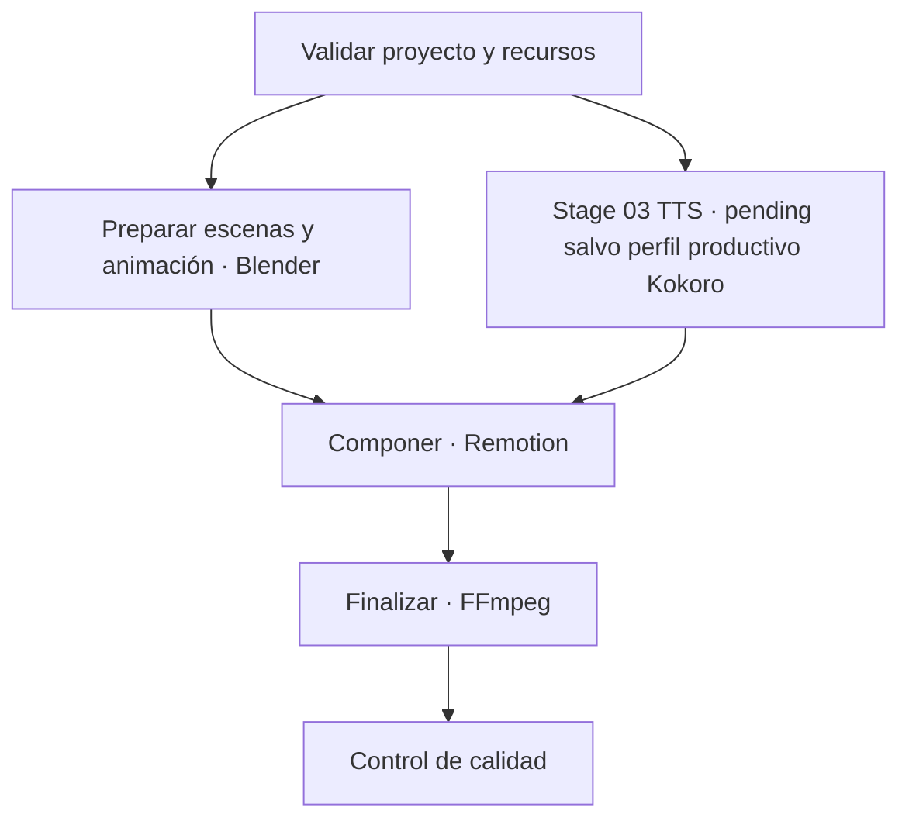

# Orquestación local del pipeline

## Alcance

El pipeline versionado usa `pipeline_version: 1`, independiente de `schema_version: 1` en storyboards. Describe un DAG local determinista. La CLI valida el storyboard con el validador compartido. `validate`, `plan`, `dry-run`, `validate-manifest` y la simulación en memoria no ejecutan etapas; `run-productive-tts` ejecuta Stage 01/03 en el perfil Kokoro y `run-productive-scenes` ejecuta Stage 01/02 en el perfil Blender. No descarga recursos, instala herramientas ni invoca Remotion o FFmpeg.

La carpeta que contiene `pipeline.json` es la raíz del proyecto. El storyboard y los recursos se nombran con rutas POSIX relativas a esa raíz. Se rechazan rutas absolutas, segmentos `..`, separadores Windows y enlaces simbólicos que resuelvan fuera del proyecto. Las salidas de etapa deben quedar bajo `workspace.intermediate_dir` o `workspace.artifact_dir`; los manifiestos usan `workspace.manifest_dir`. Los comandos de planificación no crean esos directorios; los comandos de publicación/ejecución sí crean sus destinos exclusivos.

## Contrato

- `project`: ID estable, ruta del storyboard y recursos (`id`, `path`, `required`, `kind` opcional). Las etapas hacen referencia a un recurso como `resource-<id>`.
- `profile`: ancho, alto, FPS, formato y límites de CPU/RAM/VRAM/concurrencia. El FPS debe coincidir con `storyboard.fps`; v0.5 no retima. Si el storyboard declara `aspect_ratio`, ancho y alto deben tener esa misma proporción; sus componentes deben tener como máximo 128 dígitos y todavía no hay recorte ni adaptación. La plantilla usa 540×960, 30 FPS, 2 hilos, 8 GB RAM, 3 GB VRAM y concurrencia 1 como valores conservadores para el equipo objetivo; son límites de planificación, no mediciones del motor.
- `workspace`: directorios previstos para intermedios, entregables y manifiestos. Las órdenes de solo lectura no los crean.
- `tools`: nombres ejecutables simples, requisito de versión, disponibilidad y estado del adaptador. `executable` es dato descriptivo: nunca se interpreta como comando o argumento.
- `stages`: IDs, adaptador declarativo, estado del adaptador, dependencias, referencias de entrada, artefactos de salida y herramientas requeridas. Cada entrada de artefacto se resuelve a una entrada del proyecto o a una salida producida por un ancestro del grafo.
- `retry_policy`: máximo de intentos, clases de error reintentables y política declarada de reanudación por huellas. Se valida, pero Phase 4B no implementa retries ni resume.

## Contrato narrativo TTS (v0.8, fase 1)

El pipeline v1 requiere exactamente una etapa narrativa: la heredada `03-kokoro-narration` o la neutral `03-tts-narration`. No se reescriben IDs: dependencias y manifiestos conservan el ID declarado. Configuraciones y manifiestos v1 heredados siguen validándose con sus fingerprints originales. `templates/pipeline.json` y `examples/cave-exploration/pipeline.json` conservan la forma heredada; el contrato neutral se demuestra en `examples/tts-contract/pipeline.json`.

La etapa neutral exige un objeto `tts` estricto con `provider`, `voice`, `language`, `audio` y `script_input`. Los proveedores declarados reconocidos por el código son `kokoro` y `piper`; son identificadores de contrato, no una afirmación de instalación, disponibilidad, verificación o ejecución. La etapa debe declarar exactamente una herramienta: la registrada para el proveedor elegido. No se aceptan herramientas auxiliares. Además, `03-tts-narration` depende directamente de `01-validate-project`; esta regla no se aplica a `03-kokoro-narration`. El TTS neutral sigue `pending` salvo el perfil productivo Kokoro definido más abajo. Los objetos `tts` y `tts.audio` rechazan campos desconocidos; no admiten comandos, argumentos de shell, módulos, rutas de scripts, URLs de instalación/descarga ni código.

`tts.audio` fija `container: "wav"`, `sample_rate_hz` en 16000, 22050, 24000, 32000, 44100 o 48000, `channels` en 1 o 2 y `sample_format` en `pcm_s16le`, `pcm_s24le` o `pcm_f32le`. `script_input` debe ser `resource-voiceover-script`, que también debe aparecer en `stages[].inputs`.

La etapa genérica requiere `project.resources` con `id: "voiceover-script"`, `kind: "voiceover-script"`, `required: true` y una ruta relativa confinada al proyecto. El archivo debe existir, contener UTF-8 válido y texto no vacío, y no exceder 1 MiB. Se acepta y elimina un BOM UTF-8; se rechazan bytes inválidos, contenido solo de espacios y NUL. El texto no se obtiene de captions. La ruta declarada participa en `inputs_fingerprint`; su hash también entra al fingerprint de etapa a través del input explícito.

La etapa declara exactamente dos artefactos: `narration` con extensión `.wav` y `narration-provenance` con extensión `.json`. Las reglas comunes verifican confinamiento bajo el workspace y ausencia de colisiones. En el contrato neutral pendiente no se crean artefactos ni se declaran valores medidos. En el perfil productivo, el sidecar `provenance_version: 1` registra proveedor, versiones observadas, hashes del runtime y assets, voz, idioma, parámetros WAV efectivos, duración, SHA-256 del guion y del WAV; su propio hash se registra en el manifiesto.

Los contratos neutrales de ejemplo siguen siendo de planificación. El ejemplo declara disponibilidad `not_checked` y adaptadores `pending`; la allowlist no cambia esos estados. El comando productivo solo admite el perfil ejecutable descrito en Phase 4B.

La configuración ejemplo vive junto al storyboard que referencia en `examples/cave-exploration/pipeline.json`. `templates/pipeline.json` usa el storyboard plantilla ubicado en la misma carpeta. Edita una copia para cada proyecto.

## Grafo previsto



El planificador agrupa etapas listas en olas deterministas ordenadas por ID. Blender y la etapa narrativa son independientes después de validar el proyecto; las plantillas los dejan en la misma ola. El límite de concurrencia 1 los serializa para el hardware objetivo, pero el grafo conserva la oportunidad de paralelismo futuro. Una dependencia inexistente, una entrada sin productor dependiente o un ciclo invalida la configuración.

## CLI de planificación

Desde la raíz del repositorio:

```powershell
python -B .agents/skills/cinematic-shorts-pipeline/scripts/pipeline.py validate .agents/skills/cinematic-shorts-pipeline/examples/cave-exploration/pipeline.json
python -B .agents/skills/cinematic-shorts-pipeline/scripts/pipeline.py plan .agents/skills/cinematic-shorts-pipeline/examples/cave-exploration/pipeline.json
python -B .agents/skills/cinematic-shorts-pipeline/scripts/pipeline.py dry-run .agents/skills/cinematic-shorts-pipeline/templates/pipeline.json
```

`plan` y `dry-run` muestran olas, orden, dependencias, entradas y salidas previstas, límites, herramientas y adaptadores. Una etapa viable aparece como `planned (not executed)`; una etapa con adaptador pendiente, herramienta no verificada o dependencia bloqueada aparece como `blocked`. El bloqueo se propaga a todos los descendientes. `availability: verified` es una declaración de configuración y no una comprobación del binario en esta ejecución. Ninguna etapa aparece como ejecutada o completada: estos comandos son de solo lectura y no lanzan Blender, Kokoro, Remotion ni FFmpeg.

## Fase 2A: simulación TTS en memoria

`python scripts/pipeline.py simulate-tts examples/tts-contract/pipeline.json --backend mock` es una orden explícita de simulación. No altera `pipeline_version: 1`, `manifest_version: 1`, los IDs, los fingerprints ni las dos salidas futuras del contrato. Valida la configuración, el storyboard, la dependencia directa `03-tts-narration -> 01-validate-project` y el recurso `voiceover-script`; lee como máximo 1 MiB y calcula SHA-256 sobre los mismos bytes capturados. No obtiene texto de captions.

El único backend se llama `mock` y se registra en código. No se selecciona un proveedor productivo desde el argumento de backend: el proveedor configurado (`kokoro` o `piper`) solo aparece como solicitado; el campo `provider_executed` es nulo. El mock construye un segundo exacto de silencio digital en RIFF/WAVE en memoria, con marcador `SIMULATED MOCK SILENCE; NOT SPEECH`. Acepta PCM little-endian de 16 o 24 bits e IEEE float little-endian de 32 bits, comprueba parámetros efectivos, frames, duración, cabeceras y tamaño máximo de 512 KiB, y calcula SHA-256 del WAV. El proceso imprime únicamente el resumen JSON; el guion, WAV y objeto de procedencia completo permanecen en memoria y no se escriben en disco.

La simulación no ejecuta etapas del DAG, no completa estados del manifiesto, no ejecuta Kokoro/Piper ni otras herramientas, no usa red o APIs y no genera medios productivos. No promete aislamiento de red, límites CPU/RAM/VRAM ni timeout. Los cuatro comandos originales (`validate`, `plan`, `dry-run`, `validate-manifest`) conservan su operación de solo lectura; `simulate-tts` también es de solo lectura y no crea archivos, procesos o conexiones.

## Fase 2B: publicación local de simulación

`python scripts/pipeline.py save-tts-simulation examples/tts-contract/pipeline.json` vuelve a validar el pipeline, storyboard, dependencia narrativa directa y guion UTF-8, y reutiliza el mismo backend `mock` y procedencia de fase 2A. Es el único comando que publica estos resultados; `simulate-tts` y los cuatro comandos originales siguen siendo de solo lectura.

La publicación escribe `mock-narration.wav` y `mock-provenance.json` bajo `.pipeline/simulations/tts/run-<uuid>/`, fuera de las salidas productivas declaradas por el pipeline. La ruta de destino es fija y no se lee del JSON. El comando crea los directorios por componentes tras inspeccionar entradas existentes, rechaza symlinks, junctions y atributos de reparse point expuestos por Python, crea un directorio exclusivo por ejecución y abre ambos archivos con modo exclusivo. Verifica los bytes WAV, cabeceras, formato, duración, JSON completo y hashes desde los archivos publicados; el JSON se escribe después del WAV. La publicación solo se informa como correcta tras verificar ambos archivos.

Si ocurre un fallo, el limpiador intenta quitar únicamente archivos regulares no-reparse cuya identidad de archivo se capturó al crear mediante `fstat` y se confirmó con `lstat`; después elimina el directorio de ejecución solo si su identidad coincide y está vacío. Si no puede probar identidad o ubicación, conserva el parcial e informa su ruta. No se elimina recursivamente y no se sobrescriben resultados anteriores.

El modelo de amenazas se limita a proyectos locales confiables cuyos directorios y componentes padres no sean modificados concurrentemente por actores hostiles. En Windows, el código revisa `st_file_attributes & FILE_ATTRIBUTE_REPARSE_POINT`, que cubre los reparse points reportados por Python, no solo `Path.is_junction()`; en Ubuntu se comprueba el tipo symlink con `lstat`. Esto reduce errores de configuración y colisiones en ese modelo, pero no garantiza protección TOCTOU completa ni aislamiento del sistema de archivos. El WAV y JSON no se publican como una transacción atómica: puede quedar un directorio parcial tras interrupción o identidad no verificable. La fase 2B no ejecuta TTS ni implementa reintentos, recuperación, llamadas de red, límites de CPU/RAM/VRAM o timeout, y no actualiza manifiestos.

## Fase 3B.2: piloto Kokoro local

`python scripts/pipeline.py run-tts-kokoro CONFIG --python PYTHON_ABSOLUTO --model MODELO_ONNX_ABSOLUTO --voices VOCES_ABSOLUTAS` es una operación explícita de voz real, separada de planificación, simulación y ejecución formal del DAG. Antes de invocar el worker vuelve a validar pipeline, storyboard, dependencia narrativa y guion capturado. Exige `03-tts-narration`, `provider: kokoro`, `voice: em_alex`, `language: es`, etapa aún `pending` y audio solicitado exactamente WAV mono PCM16 a 24 kHz.

El intérprete y las rutas de modelo/voces se pasan explícitamente por CLI. El worker `scripts/tts-kokoro-worker.py` es fijo y el JSON no puede seleccionar ejecutables, argumentos, módulos ni rutas. El guion UTF-8 validado, máximo 8 KiB en este piloto, se envía por stdin y no aparece en argumentos, logs, resumen ni procedencia. El proceso hijo se invoca con `shell=False`, timeout de 300 s, `ONNX_PROVIDER=CPUExecutionProvider` y sin reintentos. Usa `kokoro-onnx` 0.6.1 directamente; no llama npx, HyperFrames, APIs ni descargadores. El proveedor usado se lee de la sesión ONNX, y el worker valida las firmas reales del constructor y `Kokoro.create` antes de sintetizar.

La frecuencia devuelta debe ser 24 kHz; no se remuestrea. El worker genera RIFF/WAVE PCM16 en memoria; se limita el resultado a 16 MiB y 300 s antes de publicarlo. El verificador del proceso padre comprueba contenedor, chunks, formato efectivo, frames, duración, señal distinta de silencio, clipping digital, bytes y SHA-256. El WAV y `narration-provenance.json` se publican en un directorio nuevo bajo `.pipeline/tts-local-runs/run-<uuid>/`. La procedencia usa `simulation: false`, `execution_mode: local-standalone`, hashes del guion/WAV/modelo/voces, versiones y proveedor ONNX efectivo, tiempos de carga/inferencia y memoria máxima observada cuando el sistema lo expone.

Este piloto no usa `.pipeline/work`, `.pipeline/artifacts` ni `.pipeline/simulations/tts/`; no cambia IDs, fingerprints, `pipeline_version: 1`, `manifest_version: 1`, estado `adapter_status` ni manifiestos. Tampoco declara completada la etapa productiva. La publicación usa creación exclusiva y verificación posterior bajo el modelo de proyecto local confiable; no promete resistencia TOCTOU completa ni atomicidad transaccional de los dos archivos. El límite de salida se comprueba después de que el motor devuelve su arreglo de audio: no es un límite de RAM. El timeout detiene el worker pero no establece límites de CPU/RAM/VRAM. La ausencia de llamadas de red conocidas no equivale a aislamiento de red.

## Phase 4B: ejecución productiva local TTS v0.10

`python -B .agents/skills/cinematic-shorts-pipeline/scripts/pipeline.py run-productive-tts CONFIG --python PYTHON_ABSOLUTO --model MODELO_ONNX_ABSOLUTO --voices VOCES_ABSOLUTAS` ejecuta una síntesis local productiva. Requiere un `pipeline_version: 1` configurado explícitamente para Kokoro. El repositorio no incluye una configuración productiva lista para ejecutar ni instala runtime/modelo/voces.

### Perfil y etapas admitidas

- Stage 01 (`01-validate-project`) está `implemented` y declara como inputs `pipeline-config`, `storyboard` y los recursos requeridos representados en el recibo. `pipeline-config` es una pseudentrada reservada para Stage 01; su hash es el fingerprint semántico de la configuración parseada/canonicalizada.
- Stage 03 (`03-tts-narration`) declara `adapter_status: implemented`, `adapter: tts-narration`, proveedor/herramienta `kokoro`, y depende exclusivamente de Stage 01. Inputs incluyen `validated-plan` y `resource-voiceover-script`; outputs son exactamente `narration` WAV y `narration-provenance` JSON en las rutas del config.
- TTS productivo admite solo voz `em_alex`, idioma `es` y WAV mono PCM16 little-endian a 24 kHz. La herramienta Kokoro declara `availability: verified`, `adapter_status: implemented` y el requisito de Kokoro ONNX 0.6.1, Python `>=3.10,<3.14` y CPUExecutionProvider. Esos campos permiten elegibilidad; el worker verifica el runtime real.
- Las etapas audiovisuales 02/04/05/06 deben conservar `adapter_status: pending`; el ejecutor no las llama ni las completa. Piper, `03-kokoro-narration` legado y herramientas adicionales no son elegibles.
- `CONFIG` y las rutas absolutas de Python/modelo/voces se validan antes de la inferencia. No se acepta que el JSON seleccione comandos, módulos, argumentos, scripts o rutas runtime.

`validate`, `plan` y `dry-run` validan o muestran el perfil de forma declarativa: no prueban que haya runtime y no lanzan el worker. `dry-run` mantiene sus garantías de solo lectura. `validate-manifest` lee y valida un manifiesto existente; tampoco crea ni reanuda ejecuciones. `run-productive-tts` sí escribe el manifiesto y artefactos, e invoca una vez el worker fijo `scripts/tts-kokoro-worker.py`.

### Stage 01 y fingerprints

Stage 01 valida config, storyboard y recursos capturados, y publica `validated-plan.json` determinista, UTF-8 y sin texto narrativo, timestamps ni rutas absolutas. Incluye fingerprint semántico de config, profile/workspace relativos, resultado de validación, inputs ordenados con tamaños/SHA-256, DAG/waves y stage fingerprint. El ejecutor relee y valida el recibo antes de completar Stage 01.

No se modifica el algoritmo existente de `stage_fingerprint` ni los contratos `pipeline_version: 1` / `manifest_version: 1`. `pipeline-config` se añade como pseudentrada solo al Stage 01 productivo; configs heredadas conservan sus inputs/fingerprints. El hash de `validated-plan` es input de Stage 03 junto al guion, por lo que cambios semánticos del plan/config invalidan el fingerprint TTS. No hay reutilización selectiva en esta fase.

### Outputs, provenance y estados

El manifiesto inicial v1 se escribe en `workspace.manifest_dir/run-<uuid>/manifest.json`, con todas las etapas `pending`, `attempts: 0`. Después de publicar/verificar `validated-plan`, Stage 01 pasa a `completed` y el checkpoint del manifiesto se persiste antes de iniciar TTS. Stage 03 solo pasa a `completed` tras salida exitosa del worker, verificación de WAV/provenance, reread y hash SHA-256 de ambos archivos, comprobación de inputs sin cambios y persistencia/verificación del manifiesto final.

La provenance productiva lleva `record_type: productive-local-kokoro-tts`, `provenance_version: 1`, run/project/stage IDs, provider/voice/language, formatos solicitados y efectivos, hashes de guion/WAV/validated-plan, `runtime` y `assets`. `runtime` registra Python y seis distributions observados por el worker, worker SHA-256 y proveedores ONNX efectivos. `assets.model` y `assets.voices` registran nombre de archivo, tamaño y SHA-256; `version_identity` repite ese digest con prefijo `sha256:`. `tool_versions.kokoro` guarda los mismos identificadores runtime/assets en JSON compacto canonicalizado. No se infieren versiones semánticas de los nombres de los assets.

Stage 01 completado registra el hash releído de validated-plan. Stage 03 completado registra hashes leídos después de publicar narration y provenance. Etapas fallidas/bloqueadas no afirman artefactos reutilizables; una falla del worker deja Stage 01 completed y Stage 03 failed. En éxito, 02/04/05/06 permanecen pending. `validate-manifest` comprueba estructura, fingerprints, hashes y vuelve a comparar semánticamente validated-plan con la config, storyboard, recursos y DAG actuales; no vuelve a ejecutar ni autenticar el runtime.

El runner es serial: una llamada al adaptador, sin retries ni resume. Un crash conserva el último checkpoint durable; archivos huérfanos nunca se adoptan automáticamente. Una invocación nueva exige rutas de outputs libres; los outputs existentes causan colisión y no se sobrescriben. La recuperación es manual: inspeccionar manifiesto/archivos y usar un proyecto o rutas de salida nuevas expresamente configuradas.

## Manifiesto, huellas y reanudación

El manifiesto independiente usa `manifest_version: 1`, un UUID de ejecución, ID del proyecto, fecha ISO-8601 con zona horaria, huellas SHA-256 de configuración e inputs, y un registro por etapa. Cada registro contiene `status` (`pending`, `completed`, `failed`, `blocked`), `attempts`, `error`, `depends_on`, `artifacts`, `stage_fingerprint` y versiones reales de herramientas. El validador comprueba IDs/dependencias, límites de intentos, estados compatibles, huellas, rutas y hashes de artefactos terminados. Un estado `completed` también exige que el adaptador de etapa esté implementado y que cada herramienta requerida esté declarada `verified` y tenga adaptador implementado; esos valores son declaraciones del contrato, no una inspección del runtime por `validate-manifest`.

La reanudación selectiva descrita por el campo `retry_policy` no está implementada. Phase 4B siempre crea `run_id` nuevo, no reutiliza etapas completadas anteriores, no reintenta y no reanuda una ejecución interrumpida. Los fingerprints y hashes se validan para detectar consistencia; no son una función de resume.

`validate-manifest` valida un manifiesto ya existente y es de solo lectura. No crea ejecuciones, no reanuda tareas y no cambia estados. `run-productive-tts` completa solo Stage 01/03; `run-productive-scenes` completa solo Stage 01/02 en su perfil aprobado.

## Phase 5B.5B: escenas Blender productivas

`run-productive-scenes CONFIG --blender RUTA_ABSOLUTA` exige el perfil de escenas 540×960, 12 FPS y `[0,24)`, Stage 02 `implemented` y herramienta Blender declarada `implemented/verified`. El preflight observa Blender 5.2.x real; el worker fijo confirma el runtime dentro de Blender. La declaración `verified` no sustituye ninguna comprobación runtime. El perfil declarativo heredado con Stage 02 `pending` sigue válido para planificación, pero no ejecuta este comando. Stage 03/04/05/06 permanecen `pending`.

El padre reutiliza Stage 01 y su `validated-plan`, crea staging exclusivo, supervisa el worker, construye un ZIP classic de 27 miembros con dos JSON, un `.blend` y 24 PNG, y valida su estructura, hashes, decodificación PNG y contexto externo antes de publicación. Publica exclusivamente el ZIP, vuelve a validarlo y solo entonces persiste Stage 02 `completed` en el manifiesto v1. Una falla deja Stage 02 sin artefactos reutilizables; un ZIP huérfano tras crash requiere intervención manual. `validate-manifest` relee el ZIP en streaming y compara IDs, inputs, fingerprints, runtime declarado, seed del Scene Spec y hash exterior sin extraer, escribir ni ejecutar Blender. La validación de archivos no autentica por sí sola la ejecución ni demuestra que Blender pueda abrir el `.blend`.

## Seguridad y recursos

- `validate`, `plan`, `dry-run`, `validate-manifest` y `simulate-tts` son de solo lectura. `save-tts-simulation` publica solo el mock; `run-tts-kokoro` publica narración standalone; `run-productive-tts` escribe outputs y manifest v1 de Stage 01/03. Los runners Kokoro comparten su worker fijo con `subprocess`, `shell=False`, timeout y CPU provider; JSON no controla comandos. `run-productive-scenes` usa el worker Blender fijo y publica solo Stage 01/02. No se invocan APIs ni descargadores conocidos.
- La validación resuelve rutas y verifica confinamiento incluso frente a symlinks; inputs externos o absolutos quedan fuera del contrato.
- `.pipeline/` separa estado temporal, intermedios y artefactos locales de los archivos versionados. Phase 2B publica mock bajo `.pipeline/simulations/tts/`; el piloto standalone publica audio bajo `.pipeline/tts-local-runs/`; el runner productivo escribe outputs configurados y manifiestos bajo `.pipeline/runs/` (o `workspace.manifest_dir` declarado).
- Concurrencia inicial 1, dos hilos y presupuestos de 8 GB RAM/3 GB VRAM dejan margen al sistema en un equipo con 16 GB y GTX 1650 de 4 GB. El plan no mide consumo real.
- Blender: la plantilla genérica conserva `>=4.0,<6.0` solo como rango de planificación; el perfil productivo de escenas exige Blender 5.2.x release comprobado por preflight y worker. El gate real con Blender 5.2.3 aún no se ejecutó. Comprobar también runtime/modelo Kokoro, dependencias bloqueadas de Remotion y build de FFmpeg antes de sus ejecuciones. Registrar versiones efectivas en el manifiesto; no inferirlas de los nombres declarados aquí.
- Los futuros adaptadores deben recibir argumentos estructurados y rutas ya validadas, sin shell, y declarar timeout, límites de recursos y salidas verificables.

## Capacidades y límites

Implementado: validación del contrato/recursos/storyboard, DAG y olas deterministas, validación de manifiesto v1, simulación mock, publicación local de mock, piloto Kokoro standalone (`run-tts-kokoro`), TTS productiva (`run-productive-tts`) y escenas productivas (`run-productive-scenes`). Cada runner publica/verifica solo sus etapas y checkpoints del manifiesto v1. No es un ejecutor genérico.

Pendiente: gate local real Blender 5.2.3, composición con Remotion, finalización con FFmpeg y QA audiovisual. No hay reintentos, resume, adopción de huérfanos ni paralelismo ejecutable. `run-tts-kokoro` no actualiza manifiestos; `run-productive-tts` completa solo Stage 01/03 y `run-productive-scenes` solo Stage 01/02.
