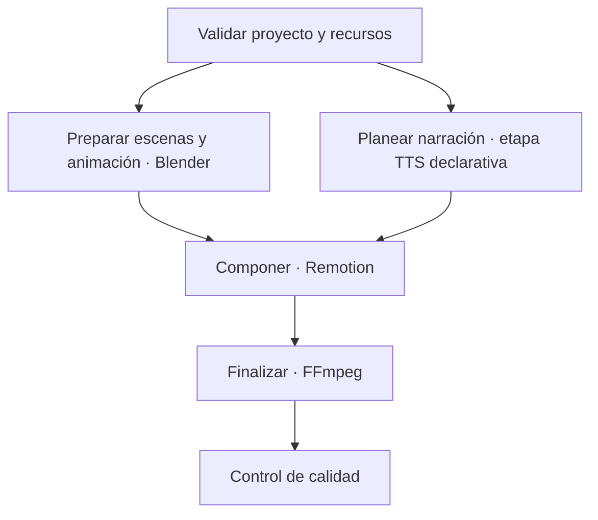

# Orquestación local del pipeline

## Alcance

El pipeline versionado usa `pipeline_version: 1`, independiente de `schema_version: 1` en storyboards. Describe un plan local y determinista; no ejecuta etapas, descarga recursos, consulta la red ni instala herramientas. La CLI valida el storyboard con el validador compartido.

La carpeta que contiene `pipeline.json` es la raíz del proyecto. El storyboard y los recursos se nombran con rutas POSIX relativas a esa raíz. Se rechazan rutas absolutas, segmentos `..`, separadores Windows y enlaces simbólicos que resuelvan fuera del proyecto. Salidas previstas deben quedar bajo `workspace.intermediate_dir` o `workspace.artifact_dir`.

## Contrato

- `project`: ID estable, ruta del storyboard y recursos (`id`, `path`, `required`, `kind` opcional). Las etapas hacen referencia a un recurso como `resource-<id>`.
- `profile`: ancho, alto, FPS, formato y límites de CPU/RAM/VRAM/concurrencia. El FPS debe coincidir con `storyboard.fps`; v0.5 no retima. Si el storyboard declara `aspect_ratio`, ancho y alto deben tener esa misma proporción; sus componentes deben tener como máximo 128 dígitos y todavía no hay recorte ni adaptación. La plantilla usa 540×960, 30 FPS, 2 hilos, 8 GB RAM, 3 GB VRAM y concurrencia 1 como valores conservadores para el equipo objetivo; son límites de planificación, no mediciones del motor.
- `workspace`: directorios previstos para intermedios, entregables y manifiestos. La CLI no los crea.
- `tools`: nombres ejecutables simples, requisito de versión, disponibilidad y estado del adaptador. `executable` es dato descriptivo: nunca se interpreta como comando o argumento.
- `stages`: IDs, adaptador declarativo, estado del adaptador, dependencias, referencias de entrada, artefactos de salida y herramientas requeridas. Cada entrada de artefacto se resuelve a una entrada del proyecto o a una salida producida por un ancestro del grafo.
- `retry_policy`: máximo de intentos, clases de error reintentables y política de reanudación por huellas. Se valida, pero no hay reintentos automáticos en v0.5.

## Contrato narrativo TTS (v0.8, fase 1)

El pipeline v1 requiere exactamente una etapa narrativa: la heredada `03-kokoro-narration` o la neutral `03-tts-narration`. No se reescriben IDs: dependencias y manifiestos conservan el ID declarado. Configuraciones y manifiestos v1 heredados siguen validándose con sus fingerprints originales. `templates/pipeline.json` y `examples/cave-exploration/pipeline.json` conservan la forma heredada; el contrato neutral se demuestra en `examples/tts-contract/pipeline.json`.

La etapa neutral exige un objeto `tts` estricto con `provider`, `voice`, `language`, `audio` y `script_input`. Los proveedores declarados reconocidos por el código son `kokoro` y `piper`; son identificadores de contrato, no una afirmación de instalación, disponibilidad, verificación o ejecución. La etapa debe declarar exactamente una herramienta: la registrada para el proveedor elegido. No se aceptan herramientas auxiliares en esta fase. Además, `03-tts-narration` depende directamente de `01-validate-project`, para que su orden sea explícito y fácil de verificar; esta regla nueva no se aplica a `03-kokoro-narration`. `adapter_status` del adaptador TTS permanece `pending`. Los objetos `tts` y `tts.audio` rechazan campos desconocidos; no admiten comandos, argumentos de shell, módulos, rutas de scripts, URLs de instalación/descarga ni código.

`tts.audio` fija `container: "wav"`, `sample_rate_hz` en 16000, 22050, 24000, 32000, 44100 o 48000, `channels` en 1 o 2 y `sample_format` en `pcm_s16le`, `pcm_s24le` o `pcm_f32le`. `script_input` debe ser `resource-voiceover-script`, que también debe aparecer en `stages[].inputs`.

La etapa genérica requiere `project.resources` con `id: "voiceover-script"`, `kind: "voiceover-script"`, `required: true` y una ruta relativa confinada al proyecto. El archivo debe existir, contener UTF-8 válido y texto no vacío, y no exceder 1 MiB. Se acepta y elimina un BOM UTF-8; se rechazan bytes inválidos, contenido solo de espacios y NUL. El texto no se obtiene de captions. La ruta declarada participa en `inputs_fingerprint`; su hash también entra al fingerprint de etapa a través del input explícito.

La etapa declara exactamente dos artefactos futuros: `narration` con extensión `.wav` y `narration-provenance` con extensión `.json`. Las reglas comunes del pipeline verifican confinamiento bajo el workspace y ausencia de colisiones. El futuro sidecar usa `provenance_version: 1` e identifica proveedor, nombre/versión real del runtime, modelo/versión, voz, idioma, parámetros WAV efectivos, duración medida, SHA-256 del guion y SHA-256 del WAV. El hash del propio sidecar corresponde al artefacto registrado en el manifiesto; no se incluye a sí mismo. En fase 1 no se crea el sidecar ni se declaran valores medidos.

Estos son contratos de planificación. En fase 1 no había comando de ejecución ni proveedor ejecutable. El ejemplo declara disponibilidad `not_checked` y adaptadores `pending`; las listas estáticas de proveedores no cambian esos estados.

La configuración ejemplo vive junto al storyboard que referencia en `examples/cave-exploration/pipeline.json`. `templates/pipeline.json` usa el storyboard plantilla ubicado en la misma carpeta. Edita una copia para cada proyecto.

## Grafo previsto



El planificador agrupa etapas listas en olas deterministas ordenadas por ID. Blender y la etapa narrativa son independientes después de validar el proyecto; las plantillas los dejan en la misma ola. El límite de concurrencia 1 los serializa para el hardware objetivo, pero el grafo conserva la oportunidad de paralelismo futuro. Una dependencia inexistente, una entrada sin productor dependiente o un ciclo invalida la configuración.

## CLI de planificación

Desde la raíz del repositorio:

```powershell
python -B .agents/skills/cinematic-shorts-pipeline/scripts/pipeline.py validate .agents/skills/cinematic-shorts-pipeline/examples/cave-exploration/pipeline.json
python -B .agents/skills/cinematic-shorts-pipeline/scripts/pipeline.py plan .agents/skills/cinematic-shorts-pipeline/examples/cave-exploration/pipeline.json
python -B .agents/skills/cinematic-shorts-pipeline/scripts/pipeline.py dry-run .agents/skills/cinematic-shorts-pipeline/templates/pipeline.json
```

`plan` y `dry-run` muestran olas, orden, dependencias, entradas y salidas previstas, límites, herramientas y adaptadores. Una etapa viable aparece como `planned (not executed)`; una etapa con adaptador pendiente, herramienta no verificada o dependencia bloqueada aparece como `blocked`. El bloqueo se propaga a todos los descendientes. `availability: verified` es una declaración de configuración y no una comprobación del binario en esta ejecución. Ninguna etapa aparece como ejecutada o completada: estos comandos son de solo lectura y no lanzan Blender, Kokoro, Remotion ni FFmpeg.

## Fase 2A: simulación TTS en memoria

`python scripts/pipeline.py simulate-tts examples/tts-contract/pipeline.json --backend mock` es una orden explícita de simulación. No altera `pipeline_version: 1`, `manifest_version: 1`, los IDs, los fingerprints ni las dos salidas futuras del contrato. Valida la configuración, el storyboard, la dependencia directa `03-tts-narration -> 01-validate-project` y el recurso `voiceover-script`; lee como máximo 1 MiB y calcula SHA-256 sobre los mismos bytes capturados. No obtiene texto de captions.

El único backend se llama `mock` y se registra en código. No se selecciona un proveedor productivo desde el argumento de backend: el proveedor configurado (`kokoro` o `piper`) solo aparece como solicitado; el campo `provider_executed` es nulo. El mock construye un segundo exacto de silencio digital en RIFF/WAVE en memoria, con marcador `SIMULATED MOCK SILENCE; NOT SPEECH`. Acepta PCM little-endian de 16 o 24 bits e IEEE float little-endian de 32 bits, comprueba parámetros efectivos, frames, duración, cabeceras y tamaño máximo de 512 KiB, y calcula SHA-256 del WAV. El proceso imprime únicamente el resumen JSON; el guion, WAV y objeto de procedencia completo permanecen en memoria y no se escriben en disco.

La simulación no ejecuta etapas del DAG, no completa estados del manifiesto, no ejecuta Kokoro/Piper ni otras herramientas, no usa red o APIs y no genera medios productivos. No promete aislamiento de red, límites CPU/RAM/VRAM ni timeout. Los cuatro comandos originales (`validate`, `plan`, `dry-run`, `validate-manifest`) conservan su operación de solo lectura; `simulate-tts` también es de solo lectura y no crea archivos, procesos o conexiones.

## Fase 2B: publicación local de simulación

`python scripts/pipeline.py save-tts-simulation examples/tts-contract/pipeline.json` vuelve a validar el pipeline, storyboard, dependencia narrativa directa y guion UTF-8, y reutiliza el mismo backend `mock` y procedencia de fase 2A. Es el único comando que publica estos resultados; `simulate-tts` y los cuatro comandos originales siguen siendo de solo lectura.

La publicación escribe `mock-narration.wav` y `mock-provenance.json` bajo `.pipeline/simulations/tts/run-<uuid>/`, fuera de las salidas productivas declaradas por el pipeline. La ruta de destino es fija y no se lee del JSON. El comando crea los directorios por componentes tras inspeccionar entradas existentes, rechaza symlinks, junctions y atributos de reparse point expuestos por Python, crea un directorio exclusivo por ejecución y abre ambos archivos con modo exclusivo. Verifica los bytes WAV, cabeceras, formato, duración, JSON completo y hashes desde los archivos publicados; el JSON se escribe después del WAV. La publicación solo se informa como correcta tras verificar ambos archivos.

Si ocurre un fallo, el limpiador intenta quitar únicamente archivos regulares no-reparse cuya identidad de archivo se capturó al crear mediante `fstat` y se confirmó con `lstat`; después elimina el directorio de ejecución solo si su identidad coincide y está vacío. Si no puede probar identidad o ubicación, conserva el parcial e informa su ruta. No se elimina recursivamente y no se sobrescriben resultados anteriores.

El modelo de amenazas se limita a proyectos locales confiables cuyos directorios y componentes padres no sean modificados concurrentemente por actores hostiles. En Windows, el código revisa `st_file_attributes & FILE_ATTRIBUTE_REPARSE_POINT`, que cubre los reparse points reportados por Python, no solo `Path.is_junction()`; en Ubuntu se comprueba el tipo symlink con `lstat`. Esto reduce errores de configuración y colisiones en ese modelo, pero no garantiza protección TOCTOU completa ni aislamiento del sistema de archivos. El WAV y JSON no se publican como una transacción atómica: puede quedar un directorio parcial tras interrupción o identidad no verificable. No hay TTS real, reintentos, recuperación, manifiesto modificado, llamadas de red, herramientas externas, límites de CPU/RAM/VRAM ni timeout.

## Manifiesto, huellas y reanudación

El manifiesto independiente usa `manifest_version: 1`, un UUID de ejecución, ID del proyecto, fecha ISO-8601 con zona horaria, huellas SHA-256 de configuración e inputs, y un registro por etapa. Cada registro contiene `status` (`pending`, `completed`, `failed`, `blocked`), `attempts`, `error`, `depends_on`, `artifacts`, `stage_fingerprint` y versiones reales de herramientas. El validador comprueba IDs/dependencias, límites de intentos, estados compatibles, huellas, rutas y hashes de artefactos terminados. Un estado `completed` también exige que el adaptador de etapa esté implementado y que cada herramienta requerida esté declarada `verified` y tenga adaptador implementado; esos valores son declaraciones del contrato, no una inspección del runtime por `validate-manifest`.

En la reanudación futura, una etapa solo puede reutilizarse si su huella recalculada coincide, sus entradas y dependencias no cambiaron y cada salida declarada existe con el mismo SHA-256. La huella de etapa incluye su configuración, perfil, hashes de entrada, requisitos de herramienta y versiones efectivamente usadas. Una diferencia invalida esa etapa y sus descendientes; etapas independientes cuyos fingerprints coincidan pueden conservarse. Los estados y artefactos parciales de una etapa fallida no son reutilizables. Si cambia el input o configuración, el manifiesto conserva procedencia, pero la etapa afectada no se marca como completada válida.

En v0.5 `validate-manifest` valida un manifiesto ya existente. No crea ejecuciones, no reanuda tareas y no escribe manifiestos. La CLI tampoco puede producir estados `completed` por sí misma.

## Seguridad y recursos

- Los cuatro comandos originales y `simulate-tts` no escriben ni ejecutan procesos o conexiones. `save-tts-simulation` es el único comando de escritura de esta fase y no ejecuta `shell=True`, `subprocess`, `os.system`, importación de comandos desde JSON ni acceso de red. El objeto TTS es declarativo y estricto; reconocer un proveedor no lo ejecuta.
- La validación resuelve rutas y verifica confinamiento incluso frente a symlinks; inputs externos o absolutos quedan fuera del contrato.
- `.pipeline/` separa estado temporal, intermedios y artefactos locales de los archivos versionados. Los artefactos de fase 2B se limitan a `.pipeline/simulations/tts/` y no satisfacen ni alteran las salidas productivas del contrato.
- Concurrencia inicial 1, dos hilos y presupuestos de 8 GB RAM/3 GB VRAM dejan margen al sistema en un equipo con 16 GB y GTX 1650 de 4 GB. El plan no mide consumo real.
- Blender: la plantilla y el ejemplo declaran `>=4.0,<6.0` como rango de planificación para incluir la versión de referencia conocida 5.2.3. Ni esta compatibilidad ni la instalación 5.2.3 se verificaron en esta ejecución; comprobar versión y procedencia localmente antes de implementar el adaptador. Comprobar también runtime/modelo Kokoro, dependencias bloqueadas de Remotion y build de FFmpeg. Registrar versiones efectivas en el manifiesto; no inferirlas de los nombres declarados aquí.
- Los futuros adaptadores deben recibir argumentos estructurados y rutas ya validadas, sin shell, y declarar timeout, límites de recursos y salidas verificables.

## Capacidades y límites

Implementado: validación del contrato y recursos requeridos, storyboard existente, grafo DAG, orden/olas deterministas, vista previa de solo lectura, validación estructural del manifiesto, contrato TTS declarativo compatible con la etapa heredada, simulación TTS `mock` en memoria (fase 2A) y publicación local verificada de esos artefactos simulados en ruta separada (fase 2B). Planificar, simular o publicar un mock no equivale a ejecutar una etapa productiva.

Pendiente: preparar/renderizar escenas, ejecutar cualquier proveedor TTS, publicar las salidas productivas declaradas por TTS, componer video, finalizar medios, QA audiovisual, invocación de herramientas, reintentos, escritura/recuperación de manifiestos y paralelismo real. La fase 2B publica únicamente silencio y procedencia etiquetados como simulación; no genera voz de producción, imágenes, modelos o video.
