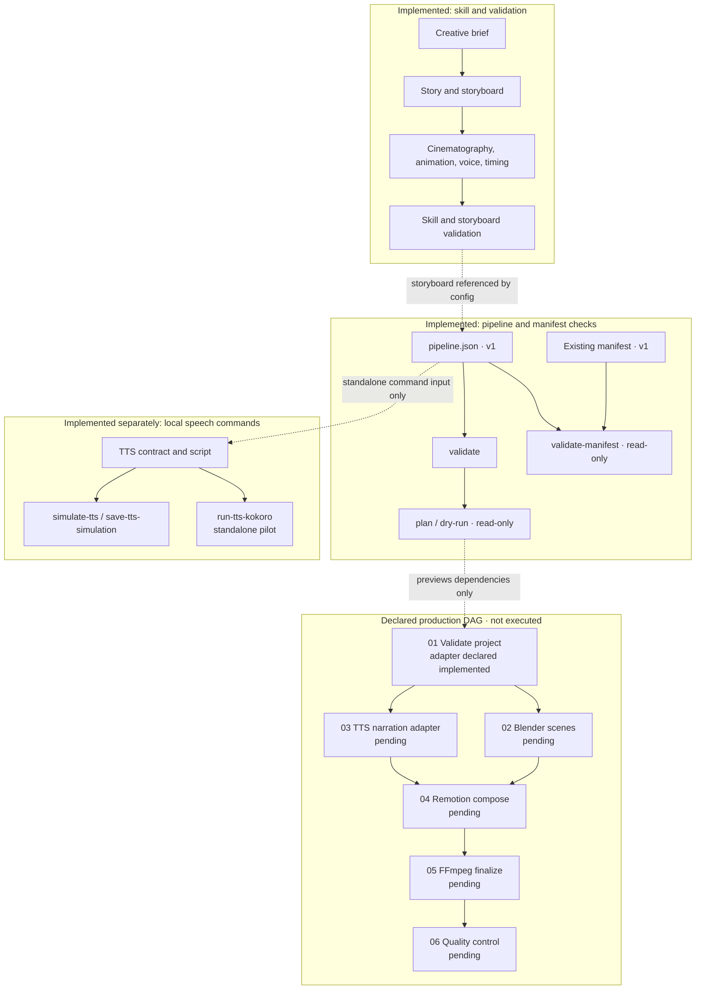
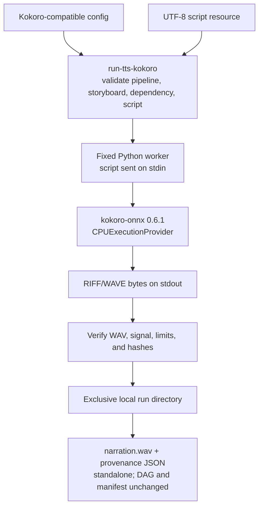

# Cinematic Shorts Pipeline

**A Codex skill and Python toolkit for planning, validating, and locally piloting parts of a cinematic 3D short workflow.** The repository turns a creative brief into reviewable story and storyboard documents, checks versioned production contracts, and includes a standalone local Kokoro speech pilot. The audiovisual production DAG is declared and inspectable; it is not an end-to-end production runner.

[](https://github.com/IsmaelZamora4/cinematic-shorts-pipeline/actions/workflows/validate.yml)
[](LICENSE)
[](.github/workflows/validate.yml)
[](.agents/skills/cinematic-shorts-pipeline/SKILL.md)

**Resumen en español:** Skill de Codex y validadores Python para planificar cortos 3D, validar storyboards y contratos de pipeline, y probar voz con Kokoro local mediante un comando independiente. Blender, Remotion, FFmpeg y la ejecución productiva del DAG siguen pendientes.

## Contents

- [Overview](#overview)
- [Current capabilities](#current-capabilities)
- [Architecture](#architecture)
- [How the pipeline works](#how-the-pipeline-works)
- [Installation and requirements](#installation-and-requirements)
- [Quick start](#quick-start)
- [Kokoro local TTS pilot](#kokoro-local-tts-pilot)
- [Examples](#examples)
- [Validation and testing](#validation-and-testing)
- [Project structure](#project-structure)
- [Security and design decisions](#security-and-design-decisions)
- [Current limitations](#current-limitations)
- [Roadmap](#roadmap)
- [Contributing and license](#contributing-and-license)

## Overview

Planning a short involves linked decisions about story, shots, art direction, motion, voice, timing, tools, and review. This project makes those decisions explicit as documents and versioned data so they can be checked before production work begins.

The repository contains a discoverable Codex skill, examples and templates, and local Python validators. It separates validated plans from production: validators check declared structures and constraints, and `run-tts-kokoro` is the only real speech synthesis command. That command is a local pilot, not execution of the production DAG.

## Current capabilities

- **Story development:** brief, premise, character goal, obstacle, stakes, causal beats, reveal, and ending guidance. See [storytelling](.agents/skills/cinematic-shorts-pipeline/references/storytelling.md).
- **Storyboard planning:** shot intent, framing, focus, continuity, lighting, and cuts. Storyboards use `schema_version: 1`; the validator checks structure and declared timing, not cinematic quality.
- **Cinematography and animation contracts:** optional per-scene `cinematography` and `animation` data describe camera, lighting, performance beats, support, root motion, gaze, hands, and props. They do not verify rigs or rendered motion. See [cinematography](.agents/skills/cinematic-shorts-pipeline/references/cinematography.md) and [animation planning](.agents/skills/cinematic-shorts-pipeline/references/animation-3d.md).
- **Voice and timing plans:** explicit UTF-8 voiceover resources, captions, and optional `narrative_timing` anchors. Validation does not prove spoken quality or word-level synchronization. See [voice and captions](.agents/skills/cinematic-shorts-pipeline/references/voice-and-captions.md).
- **Pipeline and manifest contracts:** validate a `pipeline_version: 1` DAG, preview deterministic dependency waves, and validate an existing `manifest_version: 1` manifest and its fingerprints.
- **Mock TTS:** `simulate-tts` builds and verifies a silent WAV in memory. `save-tts-simulation` explicitly publishes the mock WAV and provenance under `.pipeline/simulations/tts/`.
- **Local Kokoro pilot:** `run-tts-kokoro` runs one real CPU synthesis for `em_alex` / `es` and publishes a verified WAV with provenance under `.pipeline/tts-local-runs/`. This is independent of DAG execution.
- **Regression coverage:** standard-library tests cover validators, pipeline contracts, TTS simulation/publication, and the Kokoro worker through simulated runtime objects.

## Architecture

The planning layer validates project data and previews the graph. Mock TTS and the local Kokoro pilot are separate commands. The pipeline stages shown below are dependencies declared by configuration; the planner does not execute them.



The Kokoro command does not connect the local pilot output to the declared TTS stage. The DAG adapter remains `pending`; see [pipeline orchestration](.agents/skills/cinematic-shorts-pipeline/references/pipeline-orchestration.md) for the contract and execution boundaries.

## How the pipeline works

1. Use the [Codex skill](.agents/skills/cinematic-shorts-pipeline/SKILL.md) to turn a brief into a story, art direction, storyboard, and technical plan with review gates.
2. Validate the storyboard and project-local resources. Optional cinematography, animation, and timing blocks remain planning data.
3. Describe tools, stage dependencies, inputs, outputs, and adapter states in `pipeline.json`. `plan` and `dry-run` show the declared graph and blockers without running it.
4. Use the mock commands to inspect or retain simulated TTS output, or explicitly run the standalone Kokoro pilot when a compatible local runtime and assets are available.
5. Review generated audio manually. No command currently executes the audiovisual DAG or completes a production stage.

| Command | Effect |
| --- | --- |
| `validate CONFIG` | Validate pipeline, storyboard, resources, and contracts. |
| `plan CONFIG` | Show deterministic DAG order and execution waves. |
| `dry-run CONFIG` | Show planned stages and blockers; does not run them. |
| `validate-manifest CONFIG MANIFEST` | Validate an existing manifest; does not create or resume a run. |
| `simulate-tts CONFIG --backend mock` | Verify a mock WAV and provenance in memory; writes nothing. |
| `save-tts-simulation CONFIG` | Publish mock WAV and JSON provenance in a new local simulation directory. |
| `run-tts-kokoro CONFIG --python PATH --model PATH --voices PATH` | Run one explicit local Kokoro pilot and publish verified WAV and provenance outside the DAG outputs. |

## Installation and requirements

- **Validation and tests:** Python 3.12 is used in GitHub Actions. The validators and test suite use the Python standard library; no project dependency installation is needed for them.
- **Codex skill:** open the repository in Codex and invoke `$cinematic-shorts-pipeline`. Codex is not needed to run the validators.
- **Kokoro pilot:** requires a pre-existing compatible Python environment, `kokoro-onnx` 0.6.1, its runtime dependencies, a local ONNX model, and a local voice file. The worker supports Python 3.10 through 3.13 and refuses other versions. The repository does not bundle or download these assets.

The verified local pilot used Python 3.12.10, `kokoro-onnx` 0.6.1, ONNX Runtime 1.31.1, NumPy 2.5.4, phonemizer 3.6.0, `espeakng-loader` 0.2.4, and SoundFile 0.14.0. These are recorded observations from that runtime, not a lockfile for every environment.

## Quick start

Clone the repository and run the validators from its root:

```bash
git clone https://github.com/IsmaelZamora4/cinematic-shorts-pipeline.git
cd cinematic-shorts-pipeline

python -B .agents/skills/cinematic-shorts-pipeline/scripts/validate-skill.py .agents/skills/cinematic-shorts-pipeline
python -B -m unittest discover -s .agents/skills/cinematic-shorts-pipeline/tests -v
python -B .agents/skills/cinematic-shorts-pipeline/scripts/pipeline.py validate .agents/skills/cinematic-shorts-pipeline/examples/cave-exploration/pipeline.json
python -B .agents/skills/cinematic-shorts-pipeline/scripts/pipeline.py plan .agents/skills/cinematic-shorts-pipeline/examples/cave-exploration/pipeline.json
python -B .agents/skills/cinematic-shorts-pipeline/scripts/pipeline.py dry-run .agents/skills/cinematic-shorts-pipeline/examples/cave-exploration/pipeline.json
```

To use the skill in Codex, open the repository and invoke `$cinematic-shorts-pipeline`, then give it a planning-only request such as:

> Prepare a reviewable package for a 12-second vertical 3D mystery short about a lighthouse whose beam reveals a second moon. Include a brief, story beats, visual direction, storyboard, and technical plan. Planning only; do not generate audio, images, or video.

To try the mock TTS contract without writing files:

```bash
python -B .agents/skills/cinematic-shorts-pipeline/scripts/pipeline.py simulate-tts .agents/skills/cinematic-shorts-pipeline/examples/tts-contract/pipeline.json --backend mock
```

The `tts-contract` example currently declares Piper. It is suitable for contract validation and mock simulation only; it is **not** a Kokoro runtime configuration. See [Kokoro local TTS pilot](#kokoro-local-tts-pilot) before using the real-speech command.

## Kokoro local TTS pilot

`run-tts-kokoro` requires a neutral TTS stage configured with:

- `provider: kokoro`, `voice: em_alex`, and `language: es`;
- WAV, mono, 24 kHz, PCM 16-bit (`pcm_s16le`);
- the registered `kokoro` tool and an explicit `voiceover-script` resource;
- a local Python interpreter, Kokoro ONNX model, and voice file supplied through absolute CLI paths.

Do not pass the Piper example unchanged. The object below is only the `tts` object for the `03-tts-narration` stage. It is not a complete `pipeline.json` and is not a Kokoro-ready template shipped by this repository. Add it to a valid `pipeline_version: 1` project config, register the `kokoro` tool, set the stage's `tools` list to `["kokoro"]`, and retain the required storyboard, script resource, dependency, and output declarations.

```json
{
  "provider": "kokoro",
  "voice": "em_alex",
  "language": "es",
  "audio": {
    "container": "wav",
    "sample_rate_hz": 24000,
    "channels": 1,
    "sample_format": "pcm_s16le"
  },
  "script_input": "resource-voiceover-script"
}
```

On Windows PowerShell, run the same command with absolute local paths. Replace every `<...>` placeholder with a real path before running:

```powershell
$Pipeline = "<PROJECT_ROOT>\pipeline-kokoro.json"
$Python = "<KOKORO_ENV>\Scripts\python.exe"
$Model = "<LOCAL_ASSETS>\kokoro-v1.0.onnx"
$Voices = "<LOCAL_ASSETS>\voices-v1.0.bin"

python -B .agents/skills/cinematic-shorts-pipeline/scripts/pipeline.py run-tts-kokoro $Pipeline --python $Python --model $Model --voices $Voices
```

The command's implemented execution path is:



Run it with the absolute paths for the local interpreter and assets on your platform:

```bash
python -B .agents/skills/cinematic-shorts-pipeline/scripts/pipeline.py run-tts-kokoro path/to/pipeline-kokoro.json --python /absolute/path/to/python --model /absolute/path/to/kokoro-v1.0.onnx --voices /absolute/path/to/voices-v1.0.bin
```

The command validates the pipeline, storyboard, narrative dependency, and the same UTF-8 script bytes before starting a fixed repository worker. The worker receives the script on stdin, uses `kokoro-onnx` directly with `CPUExecutionProvider`, and runs with `shell=False`, a 300-second timeout, and no automatic retry. The parent verifies WAV format, frames, duration, finite and non-silent samples, clipping, size, and SHA-256 hashes before publication.

The pilot is limited to an 8 KiB script, 300 seconds of audio, and a 16 MiB WAV. It publishes `narration.wav` and `narration-provenance.json` in a unique `.pipeline/tts-local-runs/run-<id>/` directory. Provenance records `simulation: false`, the requested and executed provider, voice and language, effective audio properties, hashes, runtime versions, and available timing/memory measurements. It is a standalone local run: it does not write declared production outputs, update a manifest, or mark a DAG stage complete.

One real local CPU pilot with `em_alex` / `es` was validated. It is evidence that the configured local runtime produced a technically valid spoken WAV, not a benchmark or an automated quality/intelligibility assessment. GitHub Actions use test doubles and do not fetch models or run real inference.

## Examples

The repository examples are fictional planning packages, not generated media:

- [Cave Exploration](.agents/skills/cinematic-shorts-pipeline/examples/cave-exploration/plan.md): rising water and a cut rope create an immediate threat; includes a legacy pipeline example.
- [Forest Storm](.agents/skills/cinematic-shorts-pipeline/examples/forest-storm/plan.md): a storm blocks the route, and lightning reveals shelter.
- [Abandoned Research Station](.agents/skills/cinematic-shorts-pipeline/examples/abandoned-research-station/plan.md): a beacon answers from a sealed room.
- [Night Station](.agents/skills/cinematic-shorts-pipeline/examples/night-station/plan.md): a guard follows wet footprints to a sealed door.
- [TTS Contract](.agents/skills/cinematic-shorts-pipeline/examples/tts-contract/pipeline.json): provider-neutral TTS contract, with a Piper declaration for validation/mock use; adapt a copy before the Kokoro pilot.

## Validation and testing

Run the full suite and package validator:

```bash
python -B -m unittest discover -s .agents/skills/cinematic-shorts-pipeline/tests -v
python -B .agents/skills/cinematic-shorts-pipeline/scripts/validate-skill.py .agents/skills/cinematic-shorts-pipeline
```

The suite contains 154 tests. For PR #9, all three GitHub Actions jobs passed: Ubuntu 24.04 and Ubuntu 26.04 each ran 154 tests with 153 passes and one Windows-only test skipped; Windows 2025 ran 154 tests with no skips or failures. The workflow also validates the skill and examples, checks pipeline configurations and read-only plans, and validates storyboard examples. See the [PR #9 workflow run](https://github.com/IsmaelZamora4/cinematic-shorts-pipeline/actions/runs/41980377295).

The 17 Kokoro adapter tests use simulated runtime/model files and fakes. CI never downloads Kokoro assets or performs inference. The real local pilot was run separately on the operator's existing runtime and is not part of the 154-test CI suite.

Automated checks validate declared structure and contracts. They do not judge story quality, verify rig compatibility, assess spoken intelligibility, or prove audiovisual synchronization.

## Project structure

```text
.
├── .agents/skills/cinematic-shorts-pipeline/
│   ├── docs/          # Roadmap, sources, examples of process, and benchmark protocol
│   ├── examples/      # Fictional plans, storyboards, and pipeline contracts
│   ├── references/    # Narrative, visual, animation, audio, pipeline, and security guides
│   ├── scripts/       # Skill/storyboard/pipeline validators and fixed Kokoro worker
│   ├── templates/     # Storyboard and pipeline templates
│   └── tests/         # Standard-library unit and regression tests
├── .github/workflows/ # Ubuntu and Windows validation matrix
├── deliverables/      # Planning packages
├── LICENSE
└── README.md
```

## Security and design decisions

- `pipeline_version: 1`, `manifest_version: 1`, legacy stage IDs, and fingerprints are preserved. The TTS provider allowlist is declarative; configuration JSON cannot supply a shell command, module, or script to execute.
- The four planning and validation commands and `simulate-tts` are read-only. `save-tts-simulation` is an explicit mock publication. `run-tts-kokoro` is an explicit local process operation using a fixed worker and CPU provider.
- Model, voice, interpreter, and script paths are checked before execution. The pilot hashes the script, WAV, model, and voices and records the results in provenance.
- Publication uses exclusive run directories and verifies the files after writing. The supported threat model is a trusted local project whose directory parents are not being changed concurrently by hostile processes. This is not a complete TOCTOU defense or a transactional two-file commit.
- A 300-second worker timeout is enforced. The implementation does not enforce CPU or RAM limits, and the WAV size limit is checked after synthesis; it is not a memory cap. No network isolation is provided.
- The repository does not bundle Kokoro models, voice files, or other media. Check each third-party asset's license and attribution terms before use or redistribution.

## Current limitations

- The DAG is declarative and previewable; there is no production DAG runner, stage scheduling, retry, or recovery implementation.
- `run-tts-kokoro` is limited to one local provider/voice/language configuration. It does not make the Kokoro DAG adapter `implemented` or mark the TTS stage complete.
- Piper is a recognized contract provider, not an executable adapter.
- Blender scene generation, Remotion composition, FFmpeg finalization, production quality control, caption alignment, and complete video generation are not implemented as pipeline executors.
- Storyboard and timing checks do not establish visual quality, animation continuity, speech intelligibility, or synchronization. The pilot requires human listening review.
- No effective CPU/RAM/VRAM limits, network isolation, or complete TOCTOU guarantee are provided.

## Roadmap

- **v0.8 — TTS contracts and mock publication:** merged through PRs [#6](https://github.com/IsmaelZamora4/cinematic-shorts-pipeline/pull/6), [#7](https://github.com/IsmaelZamora4/cinematic-shorts-pipeline/pull/7), and [#8](https://github.com/IsmaelZamora4/cinematic-shorts-pipeline/pull/8).
- **v0.9 — Standalone Kokoro local pilot:** merged through [PR #9](https://github.com/IsmaelZamora4/cinematic-shorts-pipeline/pull/9). Real local speech generation is available only through the explicit pilot command; production DAG integration remains future work.
- **Next:** integrate TTS into the DAG with production artifact/state handling, then implement and validate audiovisual stage adapters in separately reviewed phases.

See the [full roadmap](.agents/skills/cinematic-shorts-pipeline/docs/roadmap.md) for phase details.

## Contributing and license

Focused contributions are welcome. For behavior changes, add or update tests, run the validation commands, and report exactly which checks were run. Keep mock tests separate from real-model experiments; do not add model or voice assets to the repository.

The repository is distributed under the [MIT License](LICENSE). The MIT license covers the project files; third-party models, voices, and media have separate license and attribution terms.
